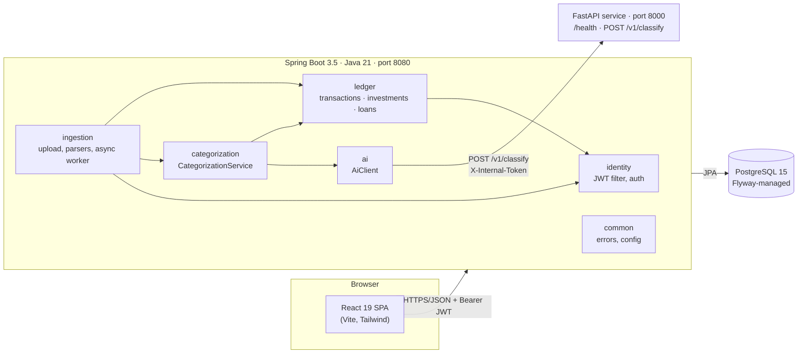
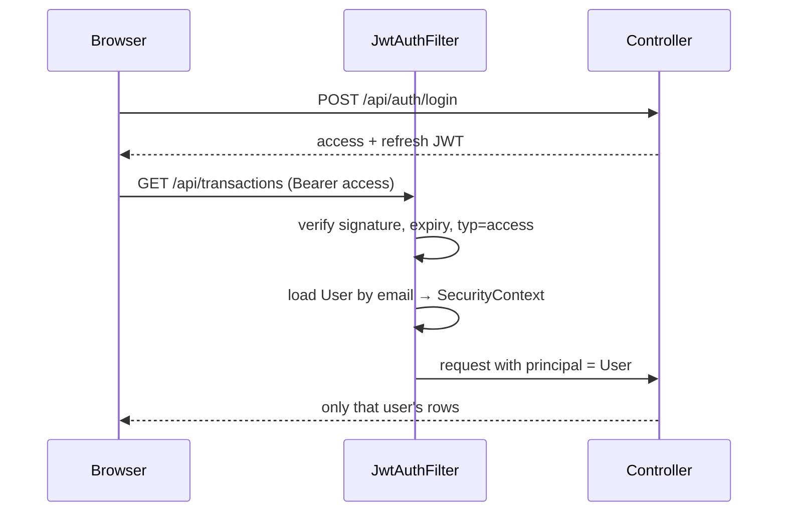
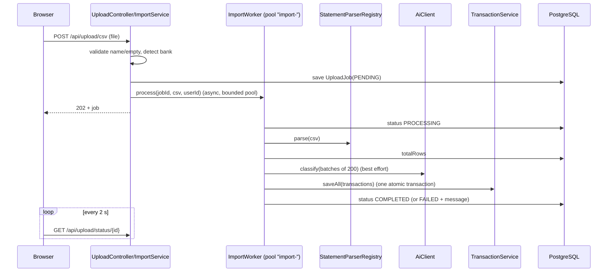
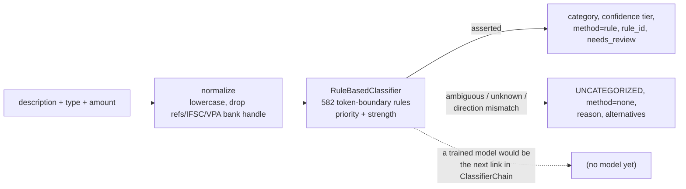
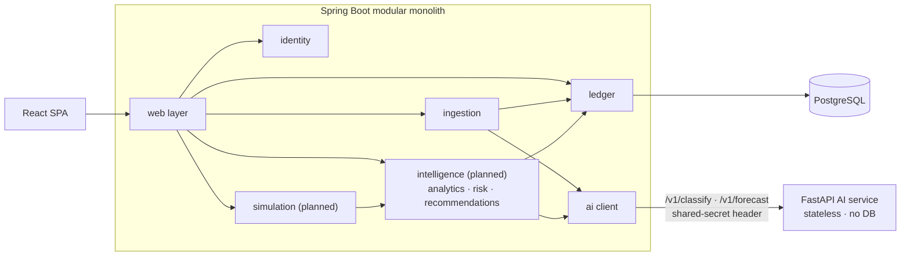
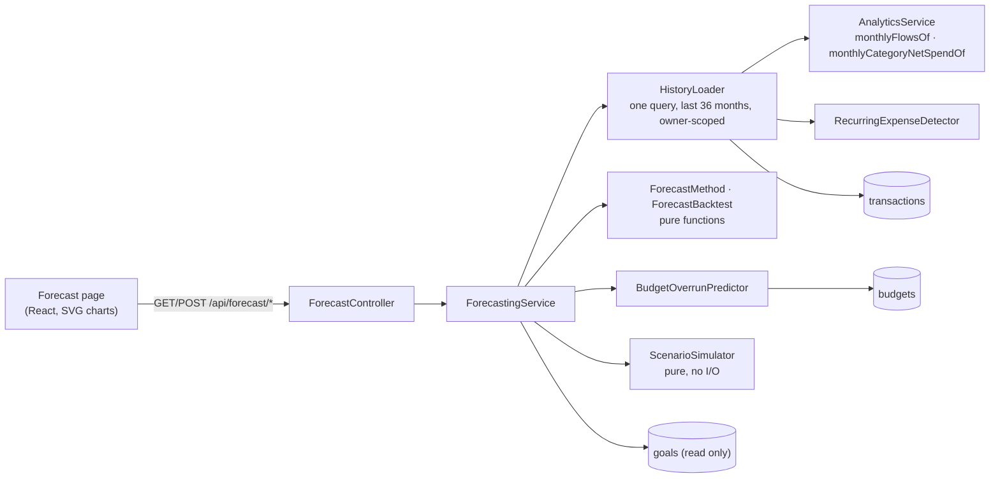

# Architecture

Status labels: see [README.md](README.md#status-vocabulary-used-in-every-document). Decisions and their reasons are
in [DECISIONS.md](DECISIONS.md).

## 1. Shape of the system (implemented)

A **modular monolith** (Spring Boot) plus a small **separate Python service**, one PostgreSQL database, and a React
single-page app. Spring Boot is the only owner of data.



| Component | Technology (observed versions) | Responsibility | Status |
|---|---|---|---|
| Backend | Spring Boot 3.5.11, Java 21, Spring Security 6.5.8, Hibernate 6.6.42, Flyway 11.7.2, jjwt 0.12.6, OpenCSV 5.9 | Authentication, all persistence, statement import, (later) all financial computation | Implemented & tested |
| Frontend | React 19, TypeScript 5.9, Vite 7, Tailwind 3.4, React Router 7, axios | UI; talks only to the backend | Implemented & tested (unit/component); not browser-tested |
| AI service | Python ≥ 3.11 (3.14.7 used locally, 3.12 in the Docker image), FastAPI 0.159, pydantic 2.14 | Stateless computation: rule-based transaction classification (`POST /v1/classify`); forecasting later | Implemented & tested (rules only — **no ML model**) |
| Database | PostgreSQL 15 | System of record | Implemented & tested |

## 2. Backend modules

Package root `com.finguard.backend`. Organized by business domain with dedicated sub-packages for entities, services, controllers, and parsers.

| Module | Contents | Depends on |
|---|---|---|
| `common` | `error` (`ApiError`, `ApiException`, `GlobalExceptionHandler`), `config` (`AsyncConfig`, `CorsProperties`) | nothing in the app |
| `identity` | `domain` (`User`, `UserRepository`); `security` (`SecurityConfig`, `JwtService`, `JwtProperties`, `JwtAuthFilter`, `RestAuthenticationHandlers`); `service` (`AuthService`); `web` (`AuthController`, requests/responses) | `common` |
| `ledger` | `transactions/`, `investments/`, `loans/` (each holding its entity, repository, service, controller, and DTO records); `transactions/TransactionCategory` is the canonical taxonomy and `AutomaticCategory` the validated automatic result | `identity.domain` (the `User` owner), `common` |
| `ingestion` | `parser` (per-bank parsers + `StatementParserRegistry`); `service` (`ImportService`, `ImportWorker`, `UploadJob`, `UploadJobRepository`); `web` (`UploadController`, `UploadStatusResponse`) | `categorization`, `ledger.transactions`, `identity`, `ai`, `common` |
| `categorization` | `CategorizationService` (asks the AI service, validates every answer, applies it through `TransactionService.applyAutomaticCategories`), `CategorizationController` (`POST /api/transactions/reclassify`), `ClassificationStatus`, `CategorizationSummary`, `ReclassifyResponse` | `ledger.transactions`, `ai`, `identity`, `common` |
| `intelligence` | `service/` (`AnalyticsService`, `RecurringExpenseDetector`, `UnusualTransactionDetector`, `InsightGenerator`), `web/` (`AnalyticsController`), `dto/` (14 typed DTOs); server-side cash flow, net metrics, recurring commitments, statistical outlier detection, data quality diagnostics | `ledger`, `identity`, `common` |
| `budgeting` | `domain/` (`Budget`, `Goal`, `GoalContribution`, `GoalStatus`), `repository/` (`BudgetRepository`, `GoalRepository`, `GoalContributionRepository`), `service/` (`BudgetService`, `GoalService`), `web/` (`BudgetController`, `GoalController`), `dto/` (12 typed DTOs); monthly spending limits (overall and category), actual vs budget performance, savings goals with concurrency-safe contribution tracking and pacing | `ledger`, `identity`, `common` |
| `forecasting` | `service/` (`ForecastMethod` and `ForecastBacktest`: pure functions; `HistoryLoader` + `ForecastHistory`: one bounded owner-scoped read per request; `ForecastingService`, `BudgetOverrunPredictor`, `ScenarioSimulator`), `web/` (`ForecastController`), `dto/`; on-demand statistical forecasts, budget month-end outlook, savings projection, scenarios, rolling-origin backtest. Persists nothing, calls no external service | `intelligence` (analytics definitions, recurring detector), `budgeting`, `ledger`, `identity`, `common` |
| `ai` | `AiClient`, `AiProperties`, `AiConfig`, `AiPrediction`, `ClassifyOutcome`, `ClassifyRequest/Response` | `common` only |

### Dependency rules — enforced by `ArchitectureTest` (ArchUnit, 11 rules)

1. `common` depends on no other module; `ai` depends on no business module.
2. `identity` is the base: it depends on none of `ledger`, `ingestion`, `ai`, `intelligence`, `budgeting`.
3. `ledger` does not depend on `ingestion`, `ai`, `categorization`, `intelligence`, or `budgeting`; `categorization` does not depend on `ingestion`.
4. `intelligence` depends on `ledger`, `identity`, and `common`, but no existing business modules (`identity`, `ledger`, `ingestion`, `categorization`, `ai`) depend on `intelligence`.
5. `budgeting` depends on `ledger`, `identity`, and `common`, but no existing business modules (`identity`, `ledger`, `ingestion`, `categorization`, `intelligence`, `ai`) depend on `budgeting`.
6. Domain entities (`@Entity`) and repositories (`*Repository`) never depend on services or controllers.
7. Controllers do not touch repositories directly.
8. Nothing outside of controllers depends on controllers.
9. No dependency cycles between modules (`slices().matching("com.finguard.backend.(*)..")`).

**Planned modules** (not created yet; created by the version that needs them): `simulation` (v0.9.0).

## 3. Key flows

### 3.1 Authentication (Implemented & tested)


An invalid, expired or wrong-type token leaves the request anonymous; the security chain then answers `401` in the
standard error format.

### 3.2 Statement import (Implemented & tested end to end on a real database; Docker path unverified)


Design points: the worker is a **separate bean** from `ImportService` because `@Async` only works across the Spring
proxy; job-state changes are committed immediately so polling sees real progress; transactions are saved atomically
after classification so a failure leaves no partial import; the pool is bounded (2 core, 5 max, queue 10) and a
rejected submission becomes `503`.

Not present: de-duplication, the bank's transaction date, a per-row error report, recovery of jobs interrupted by a
restart (KI-001, 002, 004, 007).

### 3.3 Frontend data flow (Implemented & tested at unit/component level)

`feature page → feature api.ts → shared/api/client.ts (axios) → backend`. The client adds the bearer token and, on a
`401` from a protected endpoint, clears the token and redirects to `/login`. Pages load data with the shared
`useResource` hook. **The dashboard summary is computed in the browser** (`features/dashboard/summary.ts`) from the three
list endpoints — a known limitation (KI-010), replaced in v0.6.0.

## 4. Frontend structure

```
frontend/src/
  app/
    router/       PrivateRoute, route protection tests
    App.tsx       route definitions
  shared/
    api/          axios client, error-message helper
    auth/         token storage (key "token"), expiry check
    components/   FullPageSpinner, ErrorBanner, PageNav, Modal parts, accent styles
    hooks/        useResource
    types/        shared models and error interfaces
    utils/        formatCurrency, formatDate
  features/
    auth/  transactions/  investments/  loans/  statement-import/  dashboard/
      (each: api.ts, types.ts, pages/components, tests)
  test/           test setup
```
Rule: a feature may import from `shared/` and from another feature's `types`/`api`; `shared/` imports from no feature.
(Convention only — not machine-enforced yet.)

## 5. Python AI service

`ai/app`: `main.py` (app factory), `api/health.py`, `api/classify.py`, `core/config.py` / `core/security.py`
(shared-secret check), `schemas/classify.py` (validated request/response), and `classification/` (the classifier).
Endpoints: `GET /health` and `POST /v1/classify` (contract: [API.md](API.md#internal-contract-backend--ai-service)).
`capabilities` is `["classify"]`; a test compares it with the routes that exist. Details:
[../ai/README.md](../ai/README.md).

**Classifier design.**



- `Classifier` is a protocol (`classify(item) -> Classification`); `ClassifierChain` runs classifiers in order and
  returns the first non-abstention. A trained model implements the same protocol and is appended to the chain —
  rules first, the model only for what the rules decline — without touching the API layer. A test proves this with a stub.
- The baseline is **deterministic and explainable**: every result names the rule (`dining.zomato`) and the rule-set
  version (`rules-1.0.0`). Specific beats generic (`swiggy instamart` over `swiggy`; `school fees` over `fees`).
- **It abstains rather than guesses**: unknown merchants, UPI payments to people, ATM cash, payment gateways,
  ties between categories, and a direction that does not fit (a credit that names a restaurant) all return
  `UNCATEGORIZED` with a reason and `needs_review`.
- `confidence` is a rule-strength tier, **not a calibrated probability**; `confidence_calibrated` says so.
- Stateless, no database, descriptions are never logged, request size capped (500 items, 1000 characters).

**Categorisation flow inside the backend** (`ImportWorker` → `CategorizationService`):

1. Parse and de-duplicate (unchanged). 2. **Persist the transactions** — never dependent on the AI service.
3. Ask the AI service (batches of 200; fail-fast after 2 failed batches or 90 s). 4. Validate each answer (taxonomy
id, not `UNCATEGORIZED`, suits the direction, known method). 5. Apply through `TransactionService.applyAutomaticCategories`,
which row-locks the transactions **that still have `category_source = NONE`** — a category a person set in the
meantime is therefore never overwritten, and a concurrent correction waits and wins. 6. Record the outcome on the
job (`classificationStatus`, `classifiedRows`); the import is `COMPLETED` whatever happened in steps 3–5.
`POST /api/transactions/reclassify` runs steps 3–5 for the caller's uncategorised rows.

## 6. Configuration & security model

| Concern | How it works today |
|---|---|
| Profiles | `dev` is the default profile (local DB on port 5433, built-in development JWT key, verbose logging). `SPRING_PROFILES_ACTIVE=prod` removes all defaults: DB settings and `JWT_SECRET` must be supplied; startup fails if the secret is missing or shorter than 32 bytes (`ProfilesTest`). Risk: forgetting to set `prod` runs with the dev key (KI-028). |
| Secrets | Only via environment variables; `.env` is git-ignored, `.env.example` documents them. Spring does not read `.env`; `start.ps1` and Docker Compose do. |
| Authorization | Stateless JWT; every non-auth endpoint authenticated; per-user scoping in every repository call. No roles. |
| Passwords | BCrypt (Spring default strength). Minimum length 6. |
| CORS | Property-driven allow-list. |
| Input limits | JSON validated with Bean Validation; uploads ≤ 5 MB. |
| Error disclosure | Generic 500 body; stack traces only in logs. |
| Transport security, rate limiting, security headers | **Not implemented.** (KI-013) |

## 7. Target architecture (Planned)

The target keeps the same shape — no new deployable services:



Division of work (Planned): **Java** computes everything that is a number the user relies on — summaries, risk score,
scenario deltas, recommendation rules — with `BigDecimal`. **Python** is used only where a library adds real value:
text classification and statistical forecasting.

### When a module may become its own service

Extract only when at least one is *demonstrated*, not anticipated: (a) measured CPU/memory profile conflicts with the
API's; (b) it needs an independent release cadence; (c) it needs a different runtime; (d) a separate team owns it.
Until then do **not** introduce Kafka/queues, an API gateway, service discovery, Kubernetes or a second database.
Identity, ingestion, intelligence and simulation are *not* extraction candidates in the planned releases.

## 8. Ports

| Port | Service | Notes |
|---|---|---|
| 5173 | Vite dev server | |
| 8080 | Spring Boot | |
| 8000 | AI service | `AI_HOST_PORT` in Compose |
| 5433 | PostgreSQL (host side) | container port 5432; `POSTGRES_HOST_PORT` |

## 9. Forecasting (v0.8.0)



- **Decision: implemented in Java, not in the Python service.** The release plan sketched a `POST /v1/forecast` Python endpoint (D-13). The
  chosen method is a few dozen lines of arithmetic over at most 12 numbers per series, it must reuse the Java financial definitions
  exactly, and a network hop would add a failure mode without adding capability. The Python service therefore still serves only
  `classify`; there is no AI-service dependency, so a forecast works when the AI service is down (A-16).
- **No persistence, no cache, no migration.** Forecasts are recomputed per request from the ledger; there is nothing to invalidate
  when a transaction, category, budget or goal changes. One bounded query per request (36 months) replaces the full-ledger scans.
- **Time** comes from an injectable `Clock` (`ClockConfig`); tests fix it.
- **Boundaries** (ArchUnit): `forecasting` depends on `intelligence`, `budgeting`, `ledger`, `identity`, `common` and not on `ingestion`, `ai` or `categorization`; nothing depends on `forecasting`.
