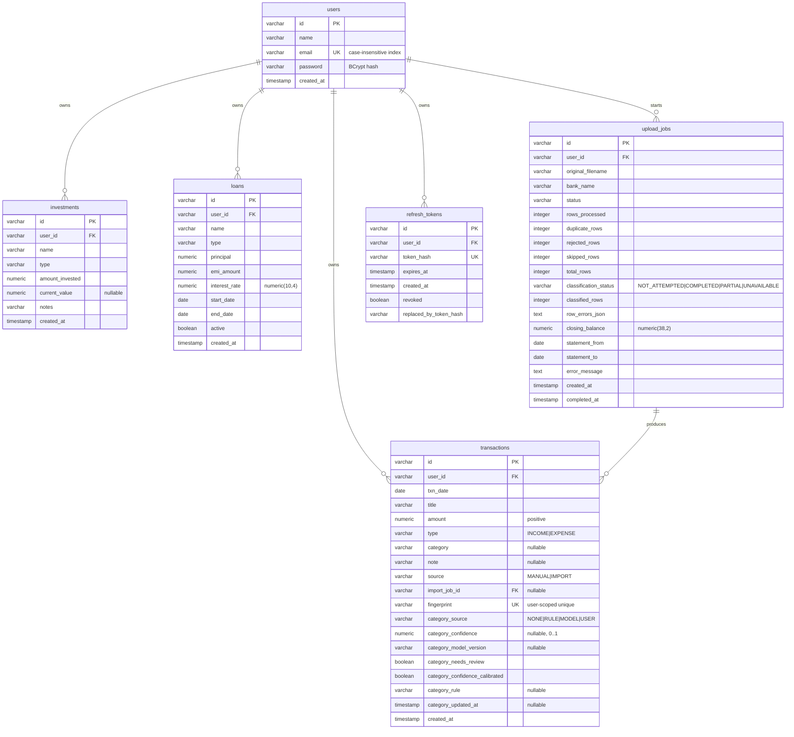

# Database

PostgreSQL 15 (Docker image `postgres:15`; tests use embedded PostgreSQL **15.19**). The schema is owned by
Flyway migrations in [`backend/src/main/resources/db/migration`](../backend/src/main/resources/db/migration);
Hibernate only **validates** it (`spring.jpa.hibernate.ddl-auto=validate`), so a schema/entity mismatch stops
the application at startup.

Status of everything below: **Implemented & tested** (migration application, entity validation and legacy-database
adoption are exercised by `BackendApplicationTests` and `LegacyDatabaseAdoptionTest`) unless marked *Planned*.

## Entity relationships

Imported rows reference their originating statement job via `transactions.import_job_id` (foreign key to `upload_jobs.id`), resolving KI-002.

## Tables (migrations `V1` – `V5`)

All ids are application-generated UUID strings (`varchar(255)`). Column names are snake_case (Spring's default
physical naming). Timestamps are `timestamp(6)` and are read and written in UTC (`hibernate.jdbc.time_zone=UTC`).

| Table | Purpose | Constraints beyond the primary key |
|---|---|---|
| `users` | Accounts | `email` unique (`uk_users_email`); `uq_users_lower_email` case-insensitive unique index; `name`, `email`, `password` not null |
| `transactions` | Money movements | `user_id` FK → `users`; `txn_date` not null; `type` check in (`INCOME`, `EXPENSE`); `source` check in (`MANUAL`, `IMPORT`); `category` check (`ck_transactions_category`): null or one of the 19 taxonomy ids; `category_source` check in (`NONE`, `RULE`, `MODEL`, `USER`); **`ck_transactions_category_provenance`: a category exists exactly when `category_source <> 'NONE'`**; `ck_transactions_category_confidence`: `category_confidence` null or within 0..1; `import_job_id` FK → `upload_jobs(id)` on delete set null; `uq_transactions_user_fingerprint` unique on `(user_id, fingerprint)` where fingerprint is not null |
| `investments` | Holdings (snapshot) | `user_id` FK → `users`; `type` check in (`STOCKS`, `MUTUAL_FUND`, `FD`, `CRYPTO`, `GOLD`, `OTHER`); `name`, `amount_invested` not null |
| `loans` | Loans (snapshot) | `user_id` FK → `users`; `type` check in (`HOME`, `CAR`, `PERSONAL`, `EDUCATION`, `OTHER`); `name`, `principal`, `emi_amount`, `interest_rate` not null; `interest_rate` is `numeric(10,4)` |
| `upload_jobs` | State of a statement import | `user_id` FK → `users`; `status` check in (`PENDING`, `PROCESSING`, `COMPLETED`, `FAILED`); `duplicate_rows`, `rejected_rows`, `skipped_rows` not null default 0; `classification_status` check in (`NOT_ATTEMPTED`, `COMPLETED`, `PARTIAL`, `UNAVAILABLE`), default `NOT_ATTEMPTED`; `classified_rows` not null default 0 |
| `refresh_tokens` | Server-side refresh token rotation | `user_id` FK → `users`; `token_hash` unique; `expires_at`, `revoked` not null |

Money amounts are `numeric(38,2)` (`transactions.amount`, `investments.*`, `loans.principal`, `loans.emi_amount`, `upload_jobs.closing_balance`).
Loan interest rate is `numeric(10,4)` allowing up to 4 decimal places (e.g. 8.7550%, resolving KI-026).

**Indexes:**
- Primary keys on all tables.
- `users`: `uk_users_email` (case-preserving), `uq_users_lower_email ON users (lower(email))`.
- `refresh_tokens`: `uq_refresh_tokens_hash ON refresh_tokens (token_hash)`, `idx_refresh_tokens_user_id ON refresh_tokens (user_id)`.
- `transactions`: `idx_transactions_user_date ON transactions (user_id, txn_date DESC, created_at DESC)`, `uq_transactions_user_fingerprint ON transactions (user_id, fingerprint) WHERE fingerprint IS NOT NULL`, `idx_transactions_user_category ON transactions (user_id, category)`, `idx_transactions_import_job_id ON transactions (import_job_id)`.
- `idx_transactions_user_category_source ON transactions (user_id, category_source)` (V5): the uncategorised listing and re-classification.
- Foreign keys: `idx_upload_jobs_user_id ON upload_jobs (user_id)`, `idx_investments_user_id ON investments (user_id)`, `idx_loans_user_id ON loans (user_id)`.

## Flyway rules

| Rule | Detail |
|---|---|
| Location | `backend/src/main/resources/db/migration`; file names `V<number>__<description>.sql` |
| Immutability | **Never edit a migration that has been merged.** Fix forward with a new version. |
| Ordering | Version numbers are assigned in merge order. |
| Validation | `ddl-auto=validate`: Hibernate checks tables and columns exist with compatible types. It does **not** check constraints or indexes — those are guarded by tests. |
| Existing databases | `spring.flyway.baseline-on-migrate=true` with `baseline-version=1`. A non-empty database without Flyway history is recorded as already at version 1 and V1 is **skipped**. Verified with data by `LegacyDatabaseAdoptionTest`. |
| Empty databases | V1 through V5 run and create the schema (`LegacyDatabaseAdoptionTest`, `BackendApplicationTests`). |
| Check constraints | Enum columns have check constraints. Adding an enum value therefore needs a migration that updates the constraint. |

### Writing a new migration (procedure)

1. Add `V<next>__short_description.sql`. Prefer additive changes: new nullable column → back-fill → add `NOT NULL`
   in a later step if needed.
2. Back-fills must be idempotent and deterministic.
3. Extend `LegacyDatabaseAdoptionTest` (or add a sibling) so a database that already holds rows is migrated and the
   rows are asserted afterwards.
4. Update the entity, run `mvnw test` (Hibernate validation will fail if they disagree), then update this document.
5. Before applying to any database that holds real data: take a `pg_dump` first. Migrations are forward-only; there
   are no down-scripts.

## Integrity rules

1. Every user-owned table has `user_id NOT NULL` with a foreign key to `users`.
2. Application code never loads or changes a user-owned row by id alone; it uses `findByIdAndUserId`
   (`OwnershipApiTest`).
3. There are no `ON DELETE CASCADE` rules on primary domain entities and no user-deletion feature.
4. Deleting a transaction, investment or loan removes only that row.
5. A transaction's `amount` is positive in the application.

## Schema migrations history

| Version | Description |
|---|---|
| `V1__baseline.sql` | Baseline tables: `users`, `transactions`, `investments`, `loans`, `upload_jobs`. |
| `V2__auth_refresh_tokens_and_email_index.sql` | `refresh_tokens` table; lowercase email normalization; pre-migration case-variant check; case-insensitive unique index `uq_users_lower_email`. |
| `V3__dated_idempotent_ledger.sql` | `transactions`: `txn_date` (backfilled from note or `created_at::date`), `source`, `import_job_id` FK, user-scoped unique `fingerprint`, category provenance (`category_source`, `category_confidence`, `category_model_version`); `upload_jobs.duplicate_rows`; widens `loans.interest_rate` to `numeric(10,4)`; adds foreign key and ledger query composite indexes. |
| `V4__resilient_ingestion_reports.sql` | `upload_jobs`: adds `rejected_rows`, `skipped_rows`, `row_errors_json`, `closing_balance`, `statement_from`, and `statement_to` for transparent row-level import reporting. |
| `V5__transaction_categorisation.sql` | Categorisation (v0.5.0). `transactions`: adds `category_needs_review`, `category_confidence_calibrated`, `category_rule`, `category_updated_at`; **normalises existing free-text categories** to the canonical taxonomy (known labels mapped — `Food`→`DINING`, `Rent`→`HOUSING`, `EMI`→`LOAN_PAYMENTS`, `Salary`/`Freelance`/`Business`/`Investment Returns`→`INCOME`, `Other`→`UNCATEGORIZED`, …; blank → null; anything else → `UNCATEGORIZED` with the original text appended to `note` as `Previous category: …`, so nothing is lost); marks every pre-existing categorised row `category_source = 'USER'` (only people could set categories before, and automation must never overwrite them); repairs rows that kept a source after their category was cleared; adds the three `CHECK` constraints above and `idx_transactions_user_category_source`. `upload_jobs`: adds `classification_status` and `classified_rows`. Verified with data by `LegacyDatabaseAdoptionTest` and the taxonomy list by `TaxonomyContractTest`. |

## Planned schema changes (not implemented)

Outline only; exact columns are fixed in the version that implements them. See [RELEASE_PLAN.md](RELEASE_PLAN.md).

| Version | Change |
|---|---|
| v0.6.0 | Transaction flow classification (transfer / refund …) and recurring-item storage if needed |
| v0.7.0 | `risk_reports` (inputs snapshot, model version, result) |
| v0.9.0 | `scenarios` |
| v0.10.0 | Optional recommendation dismissals |

