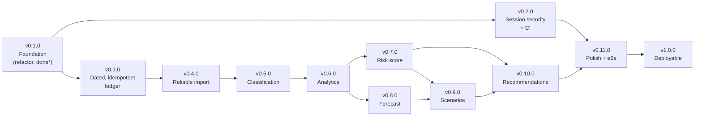

# Roadmap

From the refactored baseline to a deployable financial-intelligence platform. Per-version detail and acceptance
criteria: [RELEASE_PLAN.md](RELEASE_PLAN.md). Current state: [PROGRESS.md](PROGRESS.md). Open questions:
[DECISIONS.md](DECISIONS.md). **Everything after v0.1.0 is Planned — none of it exists.**

## 1. Product goal

A user can register, import a bank statement, review and correct categories, see their financial metrics and an
explainable risk index, view a cash-flow forecast, simulate a financial decision and see how projected outcomes change,
and receive prioritised recommendations grounded in their own data. Money figures are deterministic and
reproducible; models only suggest (categories, forecasts) and never override arithmetic or a user's choice.

## 2. Where we are

| Area | State |
|---|---|
| Register / log in / refresh | Implemented & tested (basic; hardening planned) |
| Transactions, investments, loans (CRUD, per-user isolation) | Implemented & tested |
| Statement import (5 bank layouts, async, atomic) | Implemented & tested on **synthetic** fixtures; no dates, no dedupe, silent row loss |
| Classification | Not working end to end — Java client exists, Python endpoint does not |
| Risk score, loan/investment scenarios, recommendations | **Not implemented** (analytics, budgets, goals, forecasting exist) |
| Tests / CI | 122 automated tests across three suites; **no CI** |
| Docker / deployment | Compose file exists, **unverified**; no deployment design |

## 3. Version sequence

\* implemented in the working tree; tag pending (Docker verification, version alignment, owner commit).

| Version | Theme | Primary outcome | Effort | Depends on | Owner decisions needed |
|---|---|---|---|---|---|
| **0.1.0** | Foundation | Modular, tested base; behaviour preserved | — (done) | — | D-12 |
| **0.2.0** | Session security & hygiene | Short sessions with refresh/logout, rate limits, correct error codes, **CI** | M | 0.1.0 | D-01…D-05 |
| **0.3.0** | Dated, idempotent ledger | Real transaction dates; re-import changes nothing; pagination | L | 0.1.0 | D-07 |
| **0.4.0** | Reliable import | Header-driven parsers, nothing lost silently, import report, recovery | L | 0.3.0 | D-06, D-09 |
| **0.5.0** | Classification | Real `/v1/classify`, provenance, user review & override | XL | 0.3.0, 0.4.0 | D-06, D-14 |
| **0.6.0** | Analytics | Server-side metrics, transfers/refunds handled, recurring detection, charts | L | 0.5.0 | D-08, D-10 |
| **0.7.0** | Budgeting & Goals | Monthly overall & category budgets, actual vs budget tracking, savings goals & pacing | L | 0.6.0 | — |
| **0.8.0** | Forecast | Statistical cash-flow, category, budget-outlook and savings forecasts, scenarios, backtesting; honest about thin history (Java, no ML) | L | 0.6.0, 0.7.0 | D-13 (taken: A-16) |
| **0.9.0** | Scenarios | Baseline vs scenario with explained deltas (loan, one-time, income and category what-ifs; saved and compared) | XL | 0.7.0, 0.8.0 | A-19 |
| **0.10.0** | Recommendations | Evidence-backed, prioritised guidance (rules over analytics figures; scenario presets) | M | 0.7.0 (0.9.0 for links) | A-20 |
| **0.11.0** | Polish & delivery | Responsive, accessible, containerised, browser e2e | L | 0.10.0 | — |
| **1.0.0** | Deployable | Production config, backups rehearsed, security review, demo | M | 0.11.0 | D-11 |

Effort is relative (M < L < XL); no calendar dates are given because none can be justified from evidence yet. Dates
should be added by the owner once a team capacity is known.

### Order rationale
1. **Trust before features.** Security (0.2) and data correctness (0.3, 0.4) come before anything that computes on the data: every later number inherits the quality of the ledger.
2. **Dates unlock everything.** Monthly metrics, forecasting, volatility and recurring detection are impossible without a transaction date (KI-001) — hence 0.3 before 0.5–0.9.
3. **Classification precedes analytics** because category breakdowns, recurring detection and several recommendations need categories — and because users must be able to correct them first.
4. **Risk before forecast before scenarios.** A scenario re-runs both the risk model and the forecast, so both must be reproducible first.
5. **CI is pulled forward to 0.2** (the original plan put it near the end). Every later version is large; an automated safety net pays for itself immediately.
6. **Frontend work is part of each version**, not a final phase; v0.11 is for cross-cutting quality only.

### Parallel tracks
- 0.2.0 ∥ 0.3.0 (disjoint code; only Flyway version numbers need coordination).
- The Python service skeleton, contract and training pipeline for 0.5.0 can start during 0.4.0.
- The `RISK_MODEL.md` specification (0.7.0) can be drafted and reviewed by the owner while 0.6.0 is built.
- Obtaining anonymised statements and labelled data (D-06) should start **now**; it is on the critical path of 0.4.0/0.5.0.

## 4. Milestones

| Milestone | Versions | Meaning | Product workflow step satisfied |
|---|---|---|---|
| **M1 — Trustworthy data** | 0.1 – 0.4 | Secure sessions; correct, dated, de-duplicated, fully reported imports | Register/log in ✔ (0.2) · import a statement (0.4) |
| **M2 — Understand** | 0.5 – 0.7 | Categorised data the user can correct; correct metrics; explainable risk | Review categories (0.5) · inspect metrics & risk (0.6, 0.7) |
| **M3 — Look ahead** | 0.8 – 0.10 | Forecast, scenarios, recommendations | View forecast (0.8) · simulate & understand changes (0.9) · recommendations (0.10) |
| **M4 — Ship** | 0.11 – 1.0 | Browser-verified, containerised, deployed | The complete workflow, end to end, in production |

## 5. Cross-cutting requirements (every version)

- **Isolation:** user id from the security context only; every new endpoint ships with a cross-user test.
- **Financial correctness:** `BigDecimal`; explicit exclusions; "insufficient data" is a result; deterministic and reproducible ([FINANCIAL_RULES.md](FINANCIAL_RULES.md)).
- **Honesty:** no fabricated outputs, accuracy numbers or demo data presented as real. Model outputs are labelled with their source and version.
- **Migrations:** forward-only Flyway, each with a data-bearing test ([DATABASE.md](DATABASE.md)).
- **UI states:** loading, empty, error, success and insufficient-data handled in every new view.
- **Docs & changelog** updated in the same change; the release gate in [RELEASE_PLAN.md](RELEASE_PLAN.md) applies.

## 6. Risks to the plan

| Risk | Effect | Mitigation |
|---|---|---|
| No real statements / labelled data (D-06) | Parsers and the classifier verified only on synthetic data; no honest accuracy claim possible | Request samples now; keep claims tied to reports |
| Forecast quality on short personal histories | Wide, weakly informative bands | Minimum-history refusal; transparent intervals; simple explainable method first |
| Risk-score breakpoints are judgement | Score may be over-trusted | Written, owner-approved spec; show inputs, coverage and reasoning |
| Scope of 0.5 and 0.9 | Largest versions | Slice into mergeable steps; each step independently tested |
| Single-instance assumptions (in-process rate limit, in-process worker) | Break under horizontal scaling | Documented; revisit only when a deployment requires it |
| Docker/CI not yet exercised | Late discovery of environment issues | Verify Docker for 0.1.0; CI in 0.2.0 |

## 7. Explicit non-goals (through 1.0)

Microservices beyond the existing Python service · message brokers · API gateway · Kubernetes · second database or
vector store · LLM-generated advice or numbers · multi-currency · bank-API/aggregator integrations · PDF/OCR statement
parsing · mobile apps · admin/multi-role access · account deletion · real-time market data.
