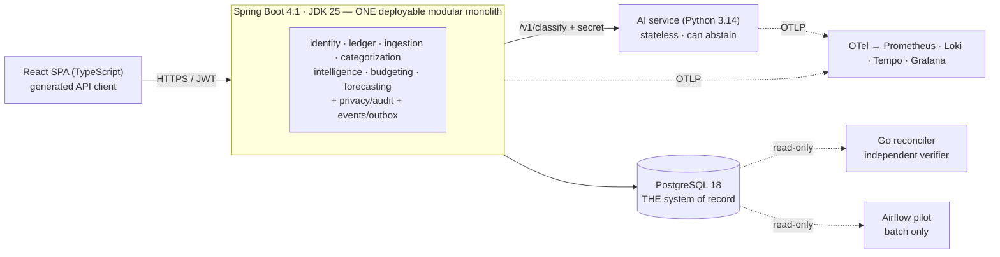

# 00 — Executive Summary

**FinGuard-AI — Next Evolution: architecture and engineering plan**
Research and inspection date: **2026-10-28** · Repository state: commit `41b38c2` on `main` (clean tree; 2 commits not yet pushed) · Status of this package: **planning only** — no application code, configuration, dependency or infrastructure was changed; the only files created are under `docs/architecture/next-evolution/`.

Evidence labels used throughout: **[V]** verified fresh · **[H]** historical claim from an existing document · **[E]** estimate · **[A]** hypothesis · **[R]** recommendation.

## 1. The answer in one page

FinGuard-AI is **functionally rich, well-structured and unusually well tested for its size**: 665 automated tests pass (387 backend / 150 frontend / 128 AI, re-run today **[V]**), module boundaries are machine-enforced, money is exact decimal with one rounding mode, imports are idempotent at the database level, and the AI layer can abstain and never overrides a person.

Its gaps are **not in domain logic**. They are in *delivery, operations and lifecycle*:

| # | Verified gap | Why it matters |
|---|---|---|
| 1 | Spring Boot **3.5.11** is on a line whose OSS support ended 2026-06-30; runtime skew (Python 3.12 image vs 3.14 local; PG 15 vs 18; unlocked dependencies) | Nothing should ship unpatched or irreproducible |
| 2 | **Zero observability** — no health endpoint, metrics, traces, request ids or structured logs | Probes, SLOs, incident response are impossible without it |
| 3 | **No backend/frontend images; staging is Windows-PowerShell-only** and builds on the host | "Reproducible staging" does not yet exist |
| 4 | **CI has not demonstrably run on current code**; no dependency/secret/SAST scanning, no SBOM; a fresh `npm audit` shows 1 high that CI masks | Quality gates are paper tigers until proven |
| 5 | No account deletion/export/audit trail; tenant isolation is application-layer only | Required groundwork before holding real people's financial data (India's DPDP duties phase in 2026-11 → 2027-05) |
| 6 | Classifier/forecast quality on **real** data is unknown; the 100 % evaluation score is synthetic and written by the rule author | Must never be cited as accuracy |

**The strategic conclusion:** ambition belongs in *engineering quality*, not in the number of technologies. The plan therefore (a) fixes the foundation, (b) adds depth where a requirement is real (events for derived data and audit, privacy lifecycle, observability, evaluation governance, contracts), (c) diversifies the stack through narrowly scoped, independently justified projects (Go reconciler, Airflow pilot, benchmark-gated Go ingestion), and (d) moves to cloud-native delivery with infrastructure as code and a *gated* Kubernetes decision.

## 2. Direct answers to the questions the brief asked

| Question | Answer |
|---|---|
| Microservices? | **No.** Modular monolith retained; AI service stays separate (different runtime, no DB). Extraction criteria are written and none is met ([03 §4](03-target-architecture.md)). |
| Does Java ingestion need a Go extraction? | **Not for load** — 10,000 rows imported in 9.9 s including classification **[H]**. Possibly for *parser isolation* or PDF/OCR later. Decide by benchmark (S2-01); building the Go worker is conditional. |
| Does FinGuard-AI need Kafka/Redpanda/Pulsar/RabbitMQ? | **Not now; maybe later; possibly never.** A PostgreSQL outbox (Spring Modulith) with idempotent in-process consumers covers every identified need at ≈ 0.06 events/s **[E]**. A measured, two-of-five gate decides ([05 §7](05-data-and-event-architecture.md)). |
| Airflow or Dagster? | **Airflow 3.3 as an isolated pilot**, honestly justified by skills and growth path; Dagster is the technically closer fit (ADR-009). Never in the synchronous transaction path. |
| Kubernetes? | **Local pilot yes; production default is a managed container platform.** Adopt K8s in production only if ≥ 3 of 5 measured conditions hold ([03 §9](03-target-architecture.md)). |
| Rust? | **Rejected** until a measured hotspot or untrusted binary parsing exists (ADR-013). |
| ClickHouse / vector DB / OpenSearch / Spark? | **Deferred / rejected.** PostgreSQL is sufficient along an escalation ladder with a mandatory zero-delta reconciler (ADR-008). |
| LLMs / RAG for explanations? | **Not now.** If ever: wording only, numbers from Java, automated numeric verification (ADR-015). |
| OIDC provider? | **No now; passkeys pilot** (ADR-014). |

## 3. The ten highest-priority engineering initiatives

| Rank | Initiative | Roadmap | Pri | Effort | Why it ranks here |
|---:|---|---|:-:|---:|---|
| 1 | **First green CI run on current `main`** with blocking audit, SHA-pinned actions | S0-01 | P0 | 3 d | Every other claim of quality depends on a gate that has actually run |
| 2 | **Reconcile docs with code** (8 contradictions found) | S0-02 | P0 | 1.5 d | Cheap; prevents wasted work and false claims |
| 3 | **Platform currency:** Spring Boot 4.1 + JDK 25; PostgreSQL 18, Python 3.14, locks, digests | S0-03, S0-04 | P1 | 9 d | Supported, reproducible runtimes while no production data exists |
| 4 | **Supply-chain baseline + mandatory AI credential** | S0-07, S0-06 | P1 | 4 d | Closes the only open internal endpoint and the unmonitored dependency surface |
| 5 | **Containers, health endpoints, reproducible staging** | S0-05, S0-08 | P1 | 8 d | Turns "works on this laptop" into a deployable system |
| 6 | **Backup/restore rehearsal** | S0-09 | P1 | 2 d | A backup never restored is not a backup |
| 7 | **Observability foundation with SLIs** | S1-01 | P1 | 6 d | Prerequisite for SLOs, probes, capacity decisions and every later benchmark |
| 8 | **Domain events via transactional outbox** (Spring Modulith) | S1-02 | P1 | 6 d | The distributed-systems core, with zero new infrastructure |
| 9 | **Privacy lifecycle + tenant isolation hardening** (export, ordered delete, audit, RLS pilot, key rotation) | S1-05, S1-06 | P1 | 12 d | Mandatory before real users; all four V1 tables lack delete cascades **[V]** |
| 10 | **OpenAPI contract + generated TS client + AI-evaluation governance** | S1-03, S1-09 | P1 | 10 d | Prevents contract drift; makes every AI claim honest and promotable by rule |

(Next in line: Go reconciler S2-02, ingestion benchmark gate S2-01, Airflow pilot S2-03, IaC S3-01, DR S3-05.)

## 4. Recommended target architecture

Details and all diagrams: [03](03-target-architecture.md), [`diagrams/`](diagrams/). **One** backend deployable, **one** AI service, **one** SPA, **one** database. New components across all stages: observability stack, Go reconciler, isolated Airflow pilot, object storage for backups. **No broker, no second database, no mesh, no microservices.**

## 5. Proposed technology adoption sequence

| Order | Technology | Stage | Mode |
|---:|---|---|---|
| 1 | GitHub Actions hardening, Renovate, CodeQL, gitleaks, SBOM | 0 | Adopt |
| 2 | Spring Boot 4.1.x, JDK 25, Flyway (via BOM) | 0 | Adopt |
| 3 | PostgreSQL 18, Python 3.14 + hashed locks, digest-pinned images | 0 | Adopt |
| 4 | Docker BuildKit images, Compose profiles, Actuator health | 0 | Adopt |
| 5 | OpenTelemetry, Prometheus (LTS), Grafana, Loki, Tempo (local) | 1 | Adopt |
| 6 | Spring Modulith (outbox/inbox, module verification) | 1 | Adopt |
| 7 | OpenAPI + `oasdiff` + generated TypeScript types; Playwright | 1 | Adopt |
| 8 | Row-Level Security, JWT key rotation | 1 | Pilot |
| 9 | Go 1.27: benchmark harness, then reconciler | 2 | Pilot |
| 10 | Airflow 3.3 (isolated), DuckDB 2.0 offline (pinned), Parquet | 2 | Pilot |
| 11 | Passkeys (WebAuthn) | 2 | Pilot |
| 12 | OpenTofu 1.13, cosign/Trivy/Syft signing & provenance, managed container platform, PITR | 3 | Adopt |
| 13 | Kubernetes 1.36/1.37 + Helm on `kind` | 3 | Pilot (production gated) |
| — | Kafka/Redpanda, Valkey, ClickHouse, Dagster, Go ingestion worker | gated | Defer — only when their measured gates fire |
| — | Rust, RabbitMQ, Pulsar, OpenSearch, Spark, vector DB, OIDC provider, service mesh | — | Reject |

Full matrix with versions, dates, criteria: [02](02-technology-landscape.md). Project catalog and portfolio matrix: [07](07-project-catalog.md). Roadmap with the dependency graph and critical path: [08](08-implementation-roadmap.md) (≈ 156 engineering days base, ≈ 180 with conditional items; ≈ 10–12 months calendar for one engineer **[E]**).

## 6. The first implementation task — **S0-01: Establish a trustworthy CI baseline**

**Scope (exactly this, nothing more):**
1. Push the two unpushed commits to a feature branch and open a pull request so the existing workflow runs on GitHub (the push is an outward-facing action that needs the owner's go-ahead).
2. Fix whatever the first hosted run reveals so all three jobs (backend, frontend, ai-service) pass.
3. Remove the known blocker: resolve the `zod` high-severity advisory (`npm audit fix`), re-run the 150 frontend tests.
4. Make `npm audit --audit-level=high` **blocking** (remove `continue-on-error`).
5. Upgrade GitHub Actions to current majors (including `setup-python`) and **pin every `uses:` to a full commit SHA** with a version comment; set workflow `permissions: contents: read`.
6. Record the first green run URL, wall-clock time per job, and the date in `docs/PROGRESS.md`.

**Acceptance criteria:**
* All three jobs are green on a GitHub-hosted run for the PR head commit.
* The live Java↔Python tests ran and were **not skipped** (`FINGUARD_REQUIRE_LIVE_AI=true`; the 5 live tests appear in the report).
* `npm audit --audit-level=high` exits 0 in CI and a deliberately introduced vulnerable dependency (test branch) makes CI fail.
* `grep` finds no `uses:` reference that is not a 40-character SHA.
* Local suites still report 387 / 150 / 128 passing.
* No application source file changed other than `frontend/package*.json` and `.github/workflows/ci.yml`.

**Tests/benchmarks:** CI duration recorded as the baseline for later caching work. **Rollback:** revert the workflow/package commit. **Effort:** 3 engineering days.

## 7. Prerequisites that must be completed before S0-01 begins

1. **Owner authorisation to push** to `origin` (the repository is at `github.com/Viraj281105/Finguard-AI`; two commits are local only). The assistant must not push without it.
2. **GitHub Actions enabled** for the repository, and permission to open a PR (branch protection optional at this point).
3. **Clean working tree** — already true **[V]**; keep it so (commit or stash any local scratch work).
4. A decision on **branch/PR naming and merge policy** (squash vs merge) — five minutes.
5. Local toolchains confirmed working — JDK 21, Node 24, Python venv, Docker **[V]**.
6. *Not* prerequisites (do not wait for them): real bank statements (D-06), a deployment target (D-11), Spring Boot 4 research. These gate later items, not this one.

## 8. What should deliberately NOT be built yet

| Do not build (yet) | Why | The trigger that would change this |
|---|---|---|
| Kafka / Redpanda / Pulsar / RabbitMQ | No second consumer, ≈ 0.06 events/s **[E]**; a PostgreSQL outbox suffices | ≥ 2 of 5 measured conditions ([05 §7](05-data-and-event-architecture.md)) |
| Any microservice extraction (identity, ledger, analytics, forecasting) | One transaction boundary; one owner; no measured conflict | A measured trigger from `ARCHITECTURE.md §7` |
| Go ingestion service | No measured performance problem | S2-01 benchmark gate or PDF/OCR requirement |
| Rust components | No hotspot, third toolchain | Profile + exhausted alternatives |
| ClickHouse, Spark, dbt, a warehouse | PostgreSQL meets measured needs | Ladder trigger L4 ([05 §5](05-data-and-event-architecture.md)) |
| Kubernetes in production, Argo CD/Flux, service mesh, API gateway | Four containers; one operator | ≥ 3 of 5 conditions ([03 §9](03-target-architecture.md)) |
| Redis/Valkey | In-memory limiter fine at one replica | Second backend replica |
| External OIDC provider (Keycloak etc.) | One client, no SSO | SSO / second client |
| Vector DB, RAG, LLM-written explanations | No corpus, no requirement, hallucination risk to financial facts | A specific evidence-grounded use case with a verifier |
| A trained ML classifier | No real labelled data; synthetic scores prove nothing | ≥ 500 owner-labelled real transactions and the promotion gate |
| Both Airflow *and* Dagster | One orchestrator is enough | Asset lineage becomes the main need |
| OpenSearch / SIEM, multi-region active-active | No requirement | Regulatory or scale trigger |
| Bank/Account-Aggregator integrations, PDF/OCR statements, mobile apps | Out of scope until 1.0 (`KNOWN_ISSUES §E`) | Product decision with legal review |

## 9. Package map

| File | Contents |
|---|---|
| [01](01-current-state-assessment.md) | Verified baseline, strengths, weaknesses, verification results, compatibility surface |
| [02](02-technology-landscape.md) | Research, decision matrix with versions/dates/criteria, language evaluation, sources |
| [03](03-target-architecture.md) | Target architecture, boundaries, consistency guarantees, environments, K8s gate |
| [04](04-service-boundaries-and-contracts.md) | Interface catalog, contract policies, service-to-service authorization |
| [05](05-data-and-event-architecture.md) | Data ownership, event catalog, outbox/inbox, replay, analytics ladder, streaming gate |
| [06](06-security-and-reliability.md) | Threat model, auth, secrets, SLOs, DR, AI governance, privacy, supply chain |
| [07](07-project-catalog.md) | Projects A–K with acceptance criteria; portfolio matrix |
| [08](08-implementation-roadmap.md) | Four stages, 33 items, dependency graph, critical path |
| [09](09-testing-and-acceptance-criteria.md) | Test strategy, CI gates, quantified targets, benchmark method |
| [10](10-cost-and-operational-model.md) | Cost/burden at four growth stages (all estimates) |
| [11](11-architecture-decision-records.md) | 17 proposed ADRs with alternatives and revisit conditions |
| [`diagrams/`](diagrams/) | `system-context.mmd`, `target-architecture.mmd`, `event-flow.mmd`, `deployment-topology.mmd` |

**Limits of this research (read before relying on it):** versions come partly from aggregators (endoflife.date, GitHub "latest" tags) and must be re-checked on the vendor page on the day an upgrade happens; Spring's project page showed 4.1.2 without a GA label; DPDP dates come from law-firm summaries, not the Gazette; costs are estimates, not quotes; the existing audit's performance and browser results were **not** re-run; API.md, FINANCIAL_RULES.md, TESTING.md and the parser sources were not read in full. This is engineering analysis, not legal advice.
