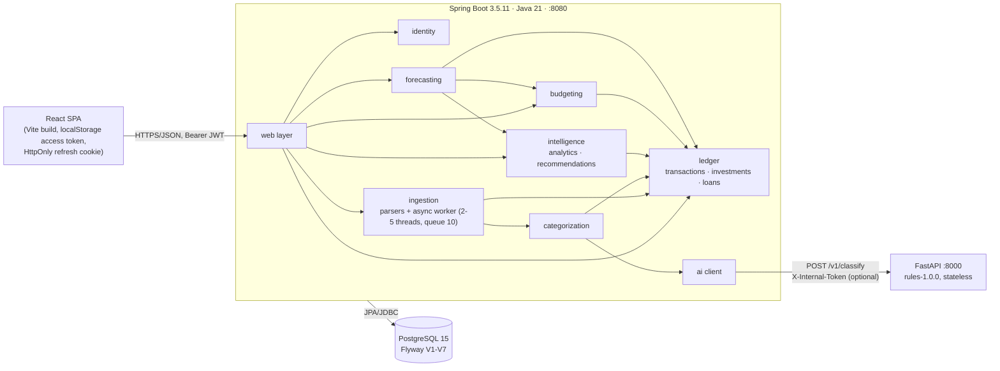

# 01 — Current-State Assessment

Researched and verified on **2026-10-28** against commit `41b38c2` (`chore: add isolated local staging stack`) on `main`.
Part of the [next-evolution planning package](00-executive-summary.md). **Planning only — no application file was changed.**

**Evidence labels used in this package**

| Label | Meaning |
|---|---|
| **[V]** | Verified fresh on 2026-10-28 by running a command or reading the exact code/config. |
| **[H]** | Historical claim from an existing repository document (audit, changelog, known issues). Not re-run. |
| **[E]** | Estimate. Assumptions are stated next to it. |
| **[A]** | Architectural hypothesis. To be validated by the acceptance criteria in [09](09-testing-and-acceptance-criteria.md). |
| **[R]** | Recommendation. |

## 1. Provenance of this baseline

| Item | Result |
|---|---|
| Repository | `D:\Projects\Full_Stack_Project\Finguard-AI`, remote `origin` = `github.com/Viraj281105/Finguard-AI` **[V]** |
| HEAD | `41b38c2` (2026-10-28 00:56 +0530) **[V]** |
| Working tree | Clean (`git status --short` empty; only ignored build output present) **[V]** |
| Remote state | `main` is **ahead of `origin/main` by 2 commits** (`462ba08` release-readiness remediation and `41b38c2` staging stack) **[V]** |
| Tags | **None** (`git tag` is empty; `CHANGELOG.md` also says no version is tagged) **[V]** |
| History | 25 commits viewed; linear feature history v0.1 → v0.10.0 plus an "Unreleased" audit-fix block **[V]** |
| Local runtime during inspection | Docker 29.7.2 up; `finguard-postgres`, `finguard-ai` (dev) and `finguard-staging-postgres`, `finguard-staging-ai` (staging) all healthy; staging backend answered `401` for an unauthenticated `GET /api/transactions` on `127.0.0.1:18080` **[V]** |
| Size (lines, computed) | Backend main Java 10,885 · backend test Java 8,656 · AI `app` Python 978 · AI tests 582 · frontend `src` TS/TSX 12,062 (tests included) **[V]** |
| Docs read in full | `ARCHITECTURE`, `KNOWN_ISSUES`, `AUDIT_E2E_2026-10-27`, parts of `ROADMAP`, `RELEASE_PLAN` (v0.11.0, v1.0.0), `CHANGELOG` head, `docker-compose*.yml`, `scripts/*.ps1`, all 7 Flyway migrations, `ci.yml`, `pom.xml`, `package.json`, `pyproject.toml`. Not read in full: `API.md` (1,016 lines), `FINANCIAL_RULES.md`, `TESTING.md`, `DATABASE.md`, `DEVELOPMENT.md`, parser sources, the 36 frontend components. |

Existing documents were treated as claims, not facts. Where a document and the code disagree this report says so (§7).

## 2. Languages, frameworks, infrastructure

| Layer | Observed technology | Source |
|---|---|---|
| Backend | Java **21** (local JDK 21.0.9), **Spring Boot 3.5.11**, Spring Data JPA/Hibernate, Spring Security, Bean Validation, Flyway (11.7.2 per docs), jjwt 0.12.6, OpenCSV 5.9, Lombok, JaCoCo 0.8.12, ArchUnit 1.4.1, `embedded-postgres` 2.2.2 with **PostgreSQL 15.19** binaries for tests | `pom.xml` **[V]** |
| Frontend | React ^19.2, TypeScript ~5.9.3, Vite ^7.3.1, Tailwind ^3.4.19, React Router ^7.13, axios, Vitest 5 + Testing Library + jsdom; CI on Node 24 (local Node 24.19.0) | `package.json`, `ci.yml` **[V]** |
| AI service | Python ≥3.11 (**3.14.7 locally, 3.12 in `ai/Dockerfile` and in CI**), FastAPI, uvicorn, pydantic; **only 3 runtime dependencies, specified as `>=` ranges, no lockfile**; rule-based classifier (`rules-1.0.0`), no ML model | `pyproject.toml`, `Dockerfile` **[V]** |
| Database | PostgreSQL **15** (image `postgres:15`), Flyway migrations V1–V7, `ddl-auto=validate` | `docker-compose.yml`, migrations **[V]** |
| Infra | Docker Compose (dev: postgres + ai; backend and frontend run on host), staging overlay (`docker-compose.staging.yml`) driven by a **Windows PowerShell** script that builds the jar and `vite preview` on the host | `scripts/staging-up.ps1` **[V]** |
| CI | One GitHub Actions workflow, 3 jobs (backend, frontend, ai-service); `actions/checkout@v4`, `setup-java@v4`, `setup-node@v4`, **`setup-python@v4`**, tag-pinned (not SHA-pinned) | `.github/workflows/ci.yml` **[V]** |
| Not present | Backend/frontend Dockerfiles, Actuator/health endpoint, metrics, tracing, structured logs, Dependabot/Renovate, SAST, secret scan, SBOM, image scan/signing, IaC, any message broker, any cache, object storage | file search + grep (0 hits for `actuator\|micrometer\|opentelemetry\|logback\|MDC` in `pom.xml` and `src/main`) **[V]** |

## 3. Architecture and dependency map

A **modular monolith** (Spring Boot) with one stateless Python service, one PostgreSQL database and a React SPA. Spring Boot is the only writer of data.

Dependency rules are enforced by `ArchitectureTest` (ArchUnit) — its 12 tests ran green on 2026-10-28 **[V]**. Module-to-module dependency direction (`identity` ← `ledger` ← `ingestion`/`categorization`/`intelligence`/`budgeting`/`forecasting`; `ai` and `common` are leaves; no cycles) matches `ARCHITECTURE.md` **[H, consistent with passing ArchUnit]**.

## 4. Confirmed strengths

Each is something to **preserve** and build on, not replace.

| # | Strength | Evidence |
|---|---|---|
| S-1 | **Enforced module boundaries**, no cycles, controllers never touch repositories. This is the precondition that makes "modular monolith first" credible. | `ArchitectureTest` green **[V]** |
| S-2 | **Schema owned by Flyway; Hibernate only validates.** A legacy-database adoption test exists. | `application.properties`, `LegacyDatabaseAdoptionTest` green **[V]** |
| S-3 | **Exact decimal money.** `numeric(38,2)` columns, `BigDecimal` arithmetic with explicit rounding in 14 service files, rounding is uniformly `RoundingMode.HALF_UP` (one deliberate `CEILING` in `ForecastingService`). | grep of 132 `RoundingMode/setScale` sites **[V]** |
| S-4 | **Idempotent import.** SHA-256 per-user fingerprint plus a *partial unique index* `uq_transactions_user_fingerprint`; a retry loop re-checks duplicates after a unique-violation. | `TransactionFingerprint.java`, V3, `ImportWorker.java` **[V]**; concurrent-import behaviour **[H]** audit E-08 |
| S-5 | **Database-level invariants** for categories and provenance: taxonomy `CHECK`, `(category_source='NONE') = (category IS NULL)`, confidence in [0,1], budget/goal amount `> 0`. | V5, V6 **[V]** |
| S-6 | **AI can abstain and never overrides a person.** Automatic categories are applied only to rows still at `category_source = NONE` under a row lock; every AI answer is validated against the taxonomy and direction; import completes even if the AI service is down. | `ARCHITECTURE.md` §5 **[H]**, `CategorizationService` uses scale/validation, AI-down tests green **[V]** |
| S-7 | **Auth is more careful than typical:** refresh rotation, row-locked redemption, reuse detection with a grace window, HttpOnly SameSite=Strict cookie, bounded LRU rate limiter keyed by (IP, email)/IP/account, trusted-proxy handling, prod fail-closed environment guard. | `AuthRateLimiter.java` **[V]**; behaviour **[H]** audit E-03, R-3, R-7 |
| S-8 | **Constant-time shared-secret check** on the AI service (`hmac.compare_digest`). | `ai/app/core/security.py` **[V]** |
| S-9 | **Live cross-language contract tests** (Java ↔ the real Python service) that CI refuses to skip. | `LiveAiServiceContractTest`, `LiveAiImportTest` ran (5 tests, not skipped) **[V]** |
| S-10 | **Honest documentation about synthetic data.** The evaluation README and `KNOWN_ISSUES` state that 100 % synthetic accuracy is an artifact of the author writing both rules and data. | `ai/evaluation/data/README.md` **[V]** |
| S-11 | **Failure behaviour was exercised:** DB outage → fast 503; oversized/odd inputs → 400; an end-to-end audit found and fixed a P0 (pagination headers hidden by CORS) that unit tests could not see. | **[H]** audit E-01, E-14 |

## 5. Confirmed weaknesses, defects, operational risks and debt

Severity uses the repository's scale (P0 blocks use or compromises data … P3 polish).

| ID | Sev | Finding | Evidence |
|---|---|---|---|
| W-01 | **P1** | **The Spring Boot 3.5 line has left OSS support** (ended 2026-06-30) and the repo pins 3.5.11 while 3.5.16 exists. Boot 4.0's OSS support ends 2026-12-31, so the sensible target is **4.1.x** (4.1.2, OSS support to 2027-07-31). No production exposure today, so not P0, but nothing security-patched should ship. | `pom.xml` **[V]**; support dates from endoflife.date (aggregator; primary source `spring.io` lists 4.1.2 as current) — see [02](02-technology-landscape.md) |
| W-02 | **P1** | **Zero observability.** No Actuator → no health/readiness endpoint (staging `GET /actuator/health` → 401), no metrics, no tracing, no request ids, no structured logs. Compose/K8s probes, SLOs and incident response cannot be built on this. | grep (0 hits), curl **[V]** |
| W-03 | **P1** | **No backend or frontend container image; staging is not reproducible.** `staging-up.ps1` runs only on Windows PowerShell, compiles on the host, starts `java -jar` and `vite preview` as hidden processes with pid files. The backend running under Docker has never existed (KI-032). | scripts, compose **[V]** |
| W-04 | **P1** | **CI has not demonstrably run on the current code.** The two newest commits are unpushed; KI-035 says the CI change itself was never run. Workflow uses `setup-python@v4`, tag-pinned actions, `npm audit … continue-on-error: true`; no dependency-update bot, no CodeQL/SAST, no secret scan, no SBOM, no image scan. | `ci.yml`, `git status -sb` **[V]** |
| W-05 | P2 | **Fresh `npm audit`: 1 high-severity advisory** (`zod` < 4.6.6, memory exhaustion; transitive, fix available). Masked in CI by `continue-on-error`. | `npm audit` 2026-10-28 **[V]** |
| W-06 | P2 | **Runtime skew and non-reproducible installs.** AI service runs Python 3.14.7 locally but 3.12 in Docker and CI; its 3 dependencies are unbounded `>=` ranges without a lock, so an image built tomorrow differs from today's. `postgres:15` is a mutable tag (PG 15 final release 2027-11-11) while 18.6 is current. Tests use PG 15.19 binaries, so they will not catch PG 18 behaviour. | `pyproject.toml`, `Dockerfile`, `pom.xml` **[V]** |
| W-07 | P2 | **`AI_INTERNAL_TOKEN` is optional.** When empty, the AI service accepts any caller; Compose defaults it to empty. Fine on loopback, wrong anywhere else (KI-033 open). | `core/security.py`, `docker-compose.yml` **[V]** |
| W-08 | P2 | **Single-instance state blocks horizontal scaling.** Login/refresh/register rate limits live in process memory; access tokens cannot be revoked for up to 15 min (O-02, O-10). Also `JwtAuthFilter` loads the user from the database on every request (design doc §3.1) — a DB read per call. | `AuthRateLimiter.java` **[V]**; **[H]** audit O-02/O-10 |
| W-09 | P2 | **No account deletion, no data export, no audit trail.** Required groundwork before holding real users' financial data in India (DPDP Rules phase in over 12–18 months from Nov 2025). Declared "out of scope until 1.0" in `KNOWN_ISSUES §E`. | docs + schema (no audit table in V1–V7) **[V]** |
| W-10 | P2 | **Tenant isolation is application-layer only.** Every repository call is user-scoped and IDOR tests pass (**[H]** audit: all 404), but there is no database-level backstop (RLS) and ids are `varchar(255)`. One forgotten `WHERE user_id` is a cross-tenant leak. | migrations **[V]** |
| W-11 | P2 | **Schema hygiene debt.** Ids are `varchar(255)` holding UUID strings; `created_at` is `timestamp` (no zone); `transactions.amount` has **no `CHECK (amount > 0)`** (validated only in the service; budgets and goals do have it); currency is implicit INR; no event/outbox table. Fixing types is a costly rewrite, so only *new* tables should use `uuid`/`timestamptz`. | V1, V6 **[V]** |
| W-12 | P2 | **Classification and forecast quality on real data is unknown.** Evaluation is 100 % on 63 dev / 134 holdout *synthetic* rows written by the rule author. This is a ceiling, not an estimate. Real statements have never been run (KI-019, KI-030, KI-040). | `ai/evaluation/metrics.json` **[V]** |
| W-13 | P3 | **Imports are not durable.** The CSV lives only in memory in a 2–5 thread pool with a queue of 10; a restart marks in-flight jobs FAILED (`ImportRecoveryListener`) and the user must re-upload (KI-007, accepted). Adequate at today's volume; not for multi-replica. | `AsyncConfig.java`, **[V]** |
| W-14 | P3 | **Frontend delivery:** one JS bundle, **488.01 kB (140.70 kB gzip)** — `KNOWN_ISSUES` still says ≈309 kB; no route-level code splitting; no browser e2e in CI (jsdom only); Tailwind 3 pending v4 migration (KI-023). Access token in `localStorage` (refresh token moved to cookie — verified by tests **[H]**). | `npm run build` **[V]** |
| W-15 | P3 | **Documentation drift** (§7). | file comparison **[V]** |
| W-16 | P3 | **HSTS not configured in the application** (CSP, nosniff, frame-deny, referrer-policy are). Acceptable only if a TLS-terminating proxy adds it; unspecified today. | `SecurityConfig.java` **[V]** |

### Technical-debt hot spots (for sizing, not for blame)

* `AnalyticsService` carries 36 rounding sites and a large share of money logic; it is the highest-risk file for future change **[V]**. Property-based tests on its invariants are worth more than new features (see [09](09-testing-and-acceptance-criteria.md)).
* The import fingerprint includes an *intra-file occurrence index*; it is deterministic for one file but means re-exporting a statement with a different row order can classify identical same-day purchases differently. Do not touch the algorithm without a migration plan (it is a backward-compatibility surface, §8) **[V — code read]**.

## 6. Verification results (fresh, 2026-10-28)

Commands were run from a clean tree. They write only git-ignored output (`backend/target`, `frontend/dist`).

| Suite | Result | Notes |
|---|---|---|
| Backend `mvnw -B test` (JDK 21.0.9, `FINGUARD_AI_PYTHON` → local venv) | **387 tests, 0 failures, 0 errors, 0 skipped. BUILD SUCCESS.** JaCoCo (computed from `jacoco.csv`): **instructions 92.6 %, branches 75.5 %** | Live Java↔Python tests ran (`LiveAiServiceContractTest` 4, `LiveAiImportTest` 1). Embedded PostgreSQL **15.19**. **[V]** |
| Frontend `tsc -b` | clean | **[V]** |
| Frontend `eslint .` | clean | **[V]** |
| Frontend `vitest run` | **19 files, 150 tests passed** | jsdom, not a real browser **[V]** |
| Frontend `vite build` | success; 488.01 kB JS / 39.26 kB CSS | **[V]** |
| Frontend `npm audit` | **1 high** (`zod`) | **[V]** |
| AI `ruff check .` | clean | **[V]** |
| AI `pytest -q` (Python 3.14.7) | **128 passed**, 1 deprecation warning (`httpx` with `starlette.testclient`) | **[V]** |
| AI `evaluation.evaluate --check` | exit 0 (metrics file is current) | dev 63 rows, holdout 134 rows, 100 % — **synthetic, same author as the rules** **[V]** |
| **Total** | **665 automated tests** (387 + 150 + 128), matches the figure in `CHANGELOG.md` | **[V]** |

**Not verified in this assessment** (so not claimed): a GitHub Actions run; the browser walk-through, the 10,000-row import in 9.9 s and the "<340 ms" analytics timings from the audit **[H]**; the staging stack end-to-end (only reachability and container health were probed); behaviour on real bank exports; screen-reader accessibility; any load test.

## 7. Documentation drift found (fix in Stage 0)

| Where | Says | Reality |
|---|---|---|
| `ARCHITECTURE.md` §6 | "Minimum length 6"; "Transport security, rate limiting, security headers — **Not implemented**" | Code requires ≥10 characters (`RegisterRequest`); rate limiter and security headers exist (`AuthRateLimiter`, `SecurityConfig`) — as `KNOWN_ISSUES` KI-013/KI-015 correctly say. HSTS is the only missing header. |
| `ARCHITECTURE.md` §2 | Planned module `simulation` | Scenario code lives in `forecasting` (§9 of the same file). |
| `KNOWN_ISSUES.md` header | "Last reviewed 2026-10-22, against the refactored working tree (not yet committed)" | Committed; many items changed since. |
| `KNOWN_ISSUES.md` | IDs **KI-030, KI-031, KI-032** are each used **twice** (a P1 classifier item and a P3 frontend/housekeeping item) | Ambiguous cross-references. |
| `KNOWN_ISSUES.md` KI-030(C) | bundle ≈309 kB | 488 kB **[V]** |
| `KNOWN_ISSUES.md` KI-018 | Docker path unverified (daemon not running) | Compose stacks were running healthy at inspection **[V]**; backend/frontend still not containerised. |
| `CHANGELOG.md` | "No version has been tagged yet" | True **[V]**; but `package.json`/`pom.xml` say 0.10.0 and the audit fixes are listed under `[Unreleased]`. |
| `README.html` | Marketing page for the *planned* product (91 % accuracy, Prophet, Nginx) | KI-020; contradicts S-10 if anyone reads it. Retire it. |

## 8. Existing functionality that must stay backward-compatible

Any change in this plan must keep these working (they are the regression surface):

1. **HTTP API in `docs/API.md`:** `/api/auth/{register,login,refresh,logout}`; `/api/transactions` (pagination headers `X-Total-Count`/`X-Page`/`X-Page-Size`/`X-Total-Pages` **exposed via CORS**; default `page=0,size=20`, `unpaged=true`; `category` absent = keep, `""` = clear); `/api/upload/csv` + `/api/upload/status/{id}`; `/api/analytics/*`; `/api/budgets` (`yearMonth` and legacy `month`); `/api/goals`; `/api/forecast/*`; saved scenarios; `/api/recommendations`; `/api/loans`; `/api/investments`; `POST /api/transactions/reclassify`. `201 Created` on creation.
2. **Error contract:** uniform `ApiError` body; 400 vs 409 semantics; 503 on DB outage; 429 + `Retry-After` on throttling.
3. **Session contract:** access JWT (`typ=access`, 15 min) in the `Authorization` header; refresh token **only** in the HttpOnly cookie, never in a JSON body; 30 s replay grace window; family revocation on later replay.
4. **Backend ↔ AI contract:** `POST /v1/classify`, `GET /health`, `X-Internal-Token`, the taxonomy in `contracts/categories.json`, example cases in `contracts/classify-examples.json`, `abstain`/`needs_review`/`confidence_calibrated` semantics.
5. **Database:** Flyway V1–V7 are immutable history; `ck_transactions_category` taxonomy; `uq_transactions_user_fingerprint` and the **fingerprint algorithm** (changing it would silently re-import duplicates of existing rows); existing `varchar` ids; the `import_job_id` linkage.
6. **Financial semantics in `docs/FINANCIAL_RULES.md`:** non-spending categories (`TRANSFERS`, `CARD_PAYMENTS`, `INVESTMENTS`) excluded from income/expense; refunds net against expenses; `netCashFlow = income + refunds − grossExpenses`; provisional (review-needed) categories treated as `Flow.UNKNOWN`; HALF_UP scale-2 rounding.
7. **Operational entry points:** `start.ps1`, `scripts/test-all.ps1`, `scripts/staging-up.ps1`/`staging-down.ps1`, the dev compose file and its env variables (`POSTGRES_*`, `AI_*`, `STAGING_*`), `.env.example`.

## 9. What this baseline implies (no invented deficiencies)

* The product is **functionally rich and unusually well tested for its size**. Its gaps are almost all in *delivery, operations and lifecycle* (images, CI proof, observability, support windows, privacy lifecycle), not in domain logic.
* There is **no demonstrated need** for a broker, a second database, microservices or Kubernetes: measured load is a single user's ledger, the audit's scale figures are **[H]** and far from any limit, and the only hard scale blocker (in-memory rate limiting) has a one-component fix (§W-08).
* The most valuable engineering work is therefore: **make what exists reproducible, observable, patched and provably correct**, then add depth where a real requirement appears (events for derived data, privacy lifecycle, evaluation governance), then diversify the stack through narrowly scoped, independently justified projects.
