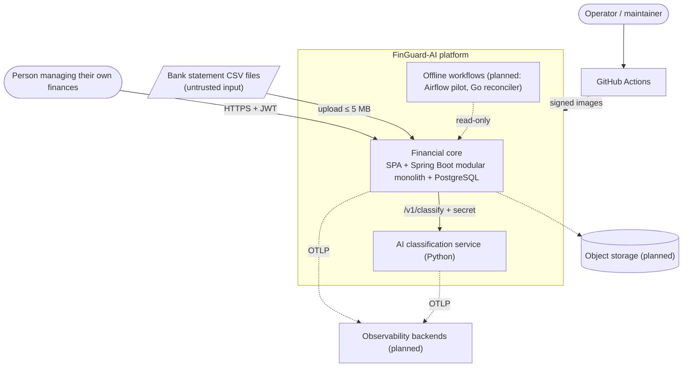
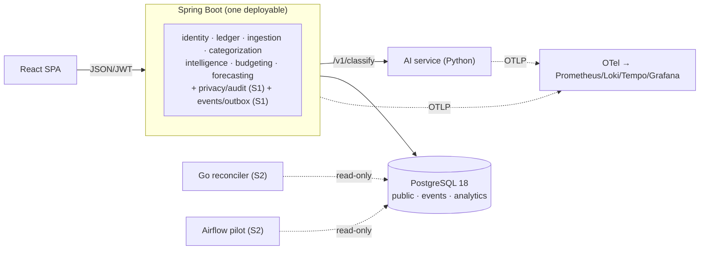

# 03 — Target Architecture

Hypothesis tested against [repository evidence](01-current-state-assessment.md) and the [technology research](02-technology-landscape.md). Labels: **[V]** verified · **[E]** estimate · **[A]** hypothesis · **[R]** recommendation. Diagrams are in [`diagrams/`](diagrams/) as Mermaid source and are embedded below.

## 1. Verdict on the starting hypothesis

| Hypothesised choice | Verdict | Reason (evidence) |
|---|---|---|
| Java/Spring Boot owns the authoritative financial domain | **Accept, and upgrade** (Boot 4.1, JDK 25) | 387 tests, ArchUnit-enforced modules, DB invariants (S-1…S-5); W-01 is a support-window problem, not a design problem |
| Go for selectively extracted services | **Accept narrowly:** reconciler first (independent verifier); ingestion extraction **only behind a measured gate** | Measured parsing is not a bottleneck **[H]** (10,000 rows in 9.9 s including AI call); Go is better for an *independent* verifier and an isolated untrusted-input worker |
| Python for AI, evaluation, data science | **Accept** (unchanged service, stronger governance) | It already exists and fits |
| TypeScript for the SPA and typed client | **Accept**, plus OpenAPI-generated types | Hand-copied DTO types are the likeliest source of contract drift |
| PostgreSQL authoritative | **Accept**, move to 18 | Only system of record; every derived store reconciles to it |
| Kafka or simpler broker when demonstrated | **Defer; use a Postgres outbox + in-process consumers** | No second consumer exists; gate in [05 §7](05-data-and-event-architecture.md) |
| Airflow/Dagster for batch | **Accept as a pilot (Airflow 3.3)** outside the request path | Real batch needs exist (evaluation, data quality, reconciliation); orchestrator is a portfolio choice and is honestly labelled so (ADR-009) |
| Kubernetes eventual target | **Pilot locally; defer in production** | Four containers do not need a control plane; gate in §9 |
| OpenTelemetry + compatible backends | **Accept** (Stage 1) | W-02: zero observability today |

**Net result:** the system keeps *one* deployable backend, *one* AI service, *one* SPA and *one* database. New runtime components added across all stages: an observability stack, a Go reconciler (batch), an Airflow pilot (batch, isolated), object storage (backups/exports). No message broker, no second database, no service mesh.

## 2. System context

Source: [`diagrams/system-context.mmd`](diagrams/system-context.mmd).

## 3. Container architecture

See [`diagrams/target-architecture.mmd`](diagrams/target-architecture.mmd) (full) — summary:

## 4. Service and module boundaries — why each exists and what would justify extraction

| Unit | Kind | Why it exists | Extract (or stay extracted) when… |
|---|---|---|---|
| `identity` | module | Auth, sessions, refresh families; base of every other module | **Not an extraction candidate** (an external IdP is a *replacement*, only for SSO/second client) |
| `ledger` | module | Transactions, loans, investments — the system-of-record writes and invariants | **Never** extract; splitting the ledger from its invariants creates distributed transactions |
| `ingestion` | module | Untrusted CSV → validated rows, async, idempotent | Extract to a Go worker **only if** the Project A gate fires: p95 import latency or memory above target at target concurrency, **or** untrusted binary formats (PDF/OCR) arrive and isolation is required |
| `categorization` | module | Applies AI answers safely (validate, row-lock, never override a person) | With `ledger` (it is a safety layer, not a service) |
| `intelligence`, `budgeting`, `forecasting` | modules | Analytics, budgets/goals, forecasts/scenarios, recommendations — all pure functions over the ledger | Stay in-process: they must use the same financial definitions; extraction adds a network hop and duplicated rules (D-13) |
| `privacy` + `audit` (new, S1) | module | Account deletion/export, append-only audit trail, retention | Stay; it must be transactional with the ledger |
| `events` (new, S1) | module | Domain events + outbox (Spring Modulith registry) | Becomes a relay component only when a broker exists |
| **AI service** | **service (exists)** | Different runtime/ecosystem, independent release cadence, resource isolation, no DB access | Stays separate. A second model-serving service is justified only if model memory/CPU profile conflicts with the classifier |
| **Go reconciler** (S2) | batch tool/job | Independent re-computation of aggregates and invariants from the ledger with read-only credentials; if it is wrong the app's own code is not the one grading itself | Stays a batch tool; becomes a service never |
| **Airflow** (S2 pilot) | platform component | Scheduled, dependency-managed batch: synthetic data → evaluation → data quality → aggregates → reports | Retired if the DAG count stays < 4 for 2 quarters; replaced by Dagster only if asset lineage becomes the main need (ADR-009) |
| **Observability stack** | platform | W-02; SLOs need data | n/a |
| **Object storage** | platform | Backups, exports, Parquet artifacts | n/a |

**Extraction decision rule (restated from `ARCHITECTURE.md §7`)** — at least one must be *demonstrated by measurement*, not anticipated: (a) the module's CPU/memory profile conflicts with the API's; (b) it needs an independent release cadence; (c) it needs a different runtime; (d) a separate team owns it. A single engineer owns everything, so (d) is false; (a)–(c) are false for every module except the AI service, which is already extracted.

## 5. Language ownership

| Language | Owns | Does **not** own |
|---|---|---|
| **Java 25 / Spring Boot 4.1** | Ledger, auth, budgets, goals, analytics, forecasts, recommendations, import pipeline, event publication, audit, every number a user relies on (`BigDecimal`, HALF_UP, scale 2) | Text classification, model training |
| **Python 3.14** | Classification service, evaluation harness, dataset tooling, Airflow DAG code | Anything that writes the ledger; any money arithmetic shown to a user |
| **TypeScript** | SPA, generated API client, e2e tests (Playwright) | Financial computation (removed in v0.6.0 — keep it that way) |
| **Go 1.27** | Reconciler, (gated) statement worker, load-test harness | Domain logic, auth |
| **SQL (PostgreSQL)** | Invariants (constraints, partial unique indexes), migrations, summary tables, RLS policies | Business rules that need history/context beyond constraints |
| **Rust** | Nothing (rejected until a measured hotspot) | — |

## 6. Communication paths

**Synchronous** (request/response, must be fast, fails visibly): SPA → API (JSON, JWT); API → AI service (`/v1/classify`, shared secret, timeouts 5 s connect / 30 s read, 90 s total budget, fail-fast after two failed batches **[V]**); API → PostgreSQL.

**Asynchronous**: (1) import worker pool (exists; durable status in `upload_jobs`); (2) domain events through the Modulith event publication registry, consumed in-process by idempotent listeners (S1/S2); (3) scheduled batch (Airflow, cron) reading exports/read-only replicas, never calling the API.

**Never synchronous:** the AI service must never be on the path that decides whether a financial fact is stored (already true: persist first, classify after **[V — ARCHITECTURE §5]**). Airflow and the reconciler must never be called by the API.

## 7. Financial transaction consistency guarantees

1. **Single-writer, single-database, local ACID transactions.** Every ledger mutation commits or rolls back in one PostgreSQL transaction. No two-phase commit, no sagas across services — there is only one writer.
2. **Outbox in the same transaction:** an event exists if and only if the change committed (proved by a rollback test, S1-02 acceptance).
3. **Idempotency:** imports by fingerprint + partial unique index **[V]**; HTTP creates/uploads by `Idempotency-Key` (S1-04); event consumers by inbox table (`processed_event`, PK `(consumer, event_id)`).
4. **Derived data is rebuildable.** `analytics` tables are caches of the ledger. A consumer recomputes affected periods from the ledger instead of applying deltas, so replays and duplicates converge to the same result.
5. **AI never silently mutates the ledger.** Automatic categories apply only to rows with `category_source = NONE`, under a row lock; user corrections win (already tested **[V]**). Model-assisted output is stored with provenance (`rule_id`, `model_version`, confidence tier, `calibrated=false`).
6. **Reconciliation is a first-class invariant:** the reconciler recomputes `income`, `expenses`, `refunds`, `netCashFlow` per user-month directly from `transactions` and requires **zero delta** against what the API/analytics tables report (Project G).
7. **Rolling-deployment safe schema:** expand → migrate → contract; no destructive change in the same release as the code that stops using it ([09 §6](09-testing-and-acceptance-criteria.md)).

## 8. Environments and developer workflow (no Kubernetes required)

| Environment | Composition | Data | Purpose |
|---|---|---|---|
| **dev** | `docker compose --profile infra up` (postgres 18, ai) + host `./mvnw spring-boot:run` + `npm run dev`; optional `--profile obs` (single `otel-lgtm`-class container); optional `--profile full` (all containers) | synthetic | Fast inner loop. This is today's workflow, kept and extended |
| **CI** | unit + embedded Postgres tests; then compose-booted stack for contract/e2e/k6 smoke; scanning and SBOM | synthetic | Proof before merge |
| **staging** | The **same images by digest** as production, `prod` profile, TLS, generated secrets, separate DB, synthetic data only | **synthetic only** (principle 13) | Release rehearsal incl. migration and rollback |
| **production** | Managed container platform + managed PostgreSQL 18 + object storage + secret manager (default) | real, consented | Users |
| **k8s pilot** | `kind`/`k3d` locally, Helm/Kustomize manifests, NetworkPolicies, HPA, probes | synthetic | Skill-building, kept honest by running the same e2e suite |

`scripts/staging-up.ps1` is replaced by compose-based staging (S0-08) so it runs identically on Windows, macOS, Linux and CI; the PowerShell script remains as a thin wrapper.

## 9. Kubernetes vs a managed container platform — the gate

**Default production target: managed container platform** (ECS Fargate/Cloud Run/Container Apps class) with managed PostgreSQL. Reasons: four stateless containers, no operator staffing, platform-native rolling revisions and autoscaling, lower fixed cost ([10](10-cost-and-operational-model.md)).

**Adopt Kubernetes in production only if ≥ 3 of these hold** (measured, written in an ADR):
1. ≥ 6 independently scaled workloads (today: 3 runtime + batch);
2. a requirement the platform cannot meet (custom networking policy, sidecar-based mesh, GPU/model serving, multi-tenant isolation per namespace);
3. portability across two clouds is a business requirement;
4. a second engineer who can be on call for the cluster;
5. sustained autoscaling needs beyond what the platform offers.

Until then the pilot (S3-06) proves the manifests, probes, NetworkPolicies, HPA and migration Job on `kind`, at zero hosting cost.

**Cluster components, if and when built (each justified):** ingress controller (north-south TLS), cert-manager (certificates), External Secrets Operator (no secrets in Git), metrics-server (HPA), Prometheus Operator or managed Prometheus (SLOs), Argo CD *or* Flux (GitOps drift control), Kyverno or Pod Security Admission (policy). **Not justified:** service mesh, API gateway, Argo Rollouts (until canary on real traffic is needed), custom operators.

## 10. Observability, reliability and DR (summary; detail in [06](06-security-and-reliability.md))

* Telemetry: OTel traces/metrics/logs from SPA-initiated request → API → AI service in one trace; PII never in telemetry.
* SLOs are defined from a *measured* baseline (S1-01), not from aspiration: availability 99.5 %/30 d for authenticated non-4xx requests, p95 ≤ 500 ms for read endpoints at ≤ 10k transactions per user, 99 % of ≤ 5 MB imports terminal within 60 s, reconciliation zero-delta daily, outbox lag p99 ≤ 60 s. All are **proposals** until a 2-week baseline exists.
* DR targets (proposal **[E]**): **RPO ≤ 5 min** (managed PITR), **RTO ≤ 2 h**, restore drilled quarterly.

## 11. Estimated infrastructure cost and burden

See [10](10-cost-and-operational-model.md): four growth stages with explicit assumptions; the key conclusion is that the architecture above stays inside a single-engineer operational budget until the third stage.

## 12. Architectural risks of this plan

| Risk | Mitigation |
|---|---|
| Boot 4 migration breaks auth/CORS subtleties the audit found | Do it first, alone, behind the 387-test suite and the E2E audit regression tests; release-note read-through |
| Outbox adds a table and a purge job that can grow unbounded | Retention job + metric on publication-table size + alert |
| Airflow pilot becomes an unmaintained second system | Exit criteria in ADR-009; a single compose profile; "fewer than 4 DAGs for 2 quarters → remove" |
| Go reconciler duplicates definitions and drifts | It *tests the definitions*: shared golden dataset with expected aggregates, used by both Java and Go tests |
| Plan exceeds one engineer's capacity | [08](08-implementation-roadmap.md) enforces at most 2 active initiatives; total ≈ 156 engineering days base (≈ 180 with conditional items) **[E]** |
