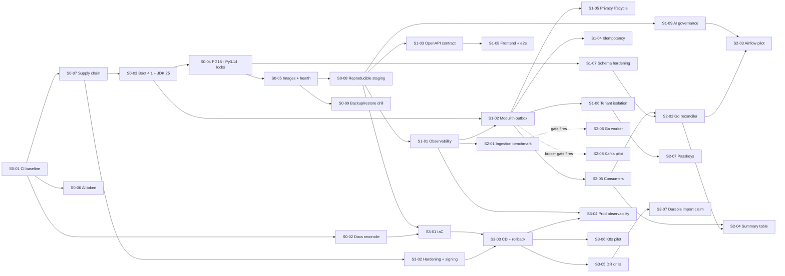

# 08 — Implementation Roadmap

Four stages, dependency-aware, sized for **one engineer** **[E]**. Effort is in engineering days (focused work; multiply by ≈ 1.4 for calendar time with reviews, context switches and reading). Priorities: **P0** blocks everything · **P1** needed for the next stage · **P2** valuable, schedulable · **P3** conditional/optional.
Rule: **at most two items in flight** (one primary, one small/background). Stages are *gates*: do not start Stage N+1 items marked "after gate" until Stage N's exit criteria are met.

| Stage | Theme | Base effort | Items |
|---|---|---:|---|
| 0 | Stabilize the foundation | 27.5 d | S0-01 … S0-09 |
| 1 | Introduce architectural depth | 46 d | S1-01 … S1-09 |
| 2 | Diversify the stack | 39 d (+23 d conditional) | S2-01 … S2-08 |
| 3 | Cloud-native evolution | 44 d (incl. 12 d Kubernetes pilot) | S3-01 … S3-07 |
| | **Total** | **≈ 156 d base · ≈ 180 d with conditional items** → ≈ 31–36 weeks focused, **≈ 10–12 months calendar** at a realistic focus factor | |

## Dependency graph and critical path

**Critical path (≈ 64 d):** S0-01 (3) → S0-07 (3) → S0-03 (6) → S0-04 (3) → S0-05 (4) → S0-08 (4) → S1-01 (6) → S1-02 (6) → S2-05 (5) → S2-02 (8) → S2-03 (10) → … S3-03 (6) → S3-05 (4). (S0-01…S1-02 is the part that cannot be reordered; the rest has slack.)
**Unrealistic parallelism avoided:** the graph shows *dependencies*, not a staffing plan — the sequencing order in the Stage tables below is the plan.

---

# Stage 0 — Stabilize the foundation (≈ 27.5 d)

**Exit criteria:** green CI on GitHub for current `main`; every runtime supported; full stack boots from images on any OS; docs match code; a restore has been rehearsed. Sequence: S0-01 → S0-02 + S0-06 → S0-07 → S0-03 → S0-04 → S0-05 → S0-08 → S0-09.

### S0-01 — Establish a trustworthy CI baseline · **P0** · 3 d
* **Problem:** CI has never demonstrably run on the current code; non-blocking audit; stale actions.
* **Evidence:** `main` ahead of `origin/main` by 2 **[V]**; KI-035; `ci.yml` uses `setup-python@v4`, `npm audit … continue-on-error` **[V]**; fresh `npm audit` shows 1 high **[V]**.
* **Proposal:** (owner pushes the 2 commits to a branch and opens a PR); run the three jobs; fix whatever fails; update actions to current majors and pin by SHA; fix the `zod` advisory (`npm audit fix`, then verify tests); make `npm audit --audit-level=high` blocking; set `permissions: contents: read`; record the first run URL in `docs/PROGRESS.md`.
* **Dependencies:** owner authorisation to push; none else. Working tree is clean **[V]**.
* **Acceptance:** all 3 jobs green on a GitHub-hosted PR run; live Java↔Python tests **not skipped** (`FINGUARD_REQUIRE_LIVE_AI=true`); `npm audit --audit-level=high` exit 0; every `uses:` pinned to a 40-char SHA with a version comment.
* **Tests/benchmarks:** CI wall-clock recorded (baseline for later caching work).
* **Security:** least-privilege token; no secrets introduced.
* **Operational cost:** GitHub Actions minutes only (free tier suffices **[E]**).
* **Rollback:** revert the workflow commit.
* **Portfolio value:** low alone, foundational.
* **Definition of done:** PR merged; badge/run link in README; PROGRESS updated.

### S0-02 — Reconcile documentation with reality · **P0** · 1.5 d
* **Problem:** contradictory docs mislead readers and future agents.
* **Evidence:** 8 drift items in [01 §7](01-current-state-assessment.md#7-documentation-drift-found-fix-in-stage-0) **[V]**.
* **Proposal:** fix `ARCHITECTURE.md` §2/§6, renumber duplicated `KNOWN_ISSUES` IDs (KI-030/031/032), update review date/headers, mark `README.html` retired, add a link to this package from `docs/README.md`, add a "docs check" script (grep for known-stale phrases) to CI.
* **Dependencies:** none. **Acceptance:** a reviewer can answer "what is the password rule / is rate limiting implemented / what is the bundle size" from docs and get the code's answer; no duplicate KI IDs (script-checked).
* **Tests:** docs-lint script. **Security:** removes false "not implemented" claims that could trigger needless work. **Cost:** none. **Rollback:** git revert. **Portfolio:** documentation discipline. **DoD:** merged, script green.

### S0-06 — Mandatory internal service credential · **P1** · 1 d
* **Problem:** AI service open when `AI_INTERNAL_TOKEN` is empty (W-07/KI-033).
* **Evidence:** `core/security.py`; Compose default empty **[V]**.
* **Proposal:** `AI_ENV` (`dev`|`staging`|`prod`); service refuses to start when `AI_ENV != dev` and the token is empty/short; backend `prod` guard also requires `ai.service.internal-token` when AI URL is non-loopback; dual-accept `AI_INTERNAL_TOKEN_PREVIOUS`.
* **Dependencies:** S0-01. **Acceptance:** tests: start-up fails with empty token in staging/prod mode; accepted with either of two tokens; rejected otherwise; backend guard test. **Tests:** pytest + `ProfilesTest` additions. **Security:** closes an open internal endpoint. **Cost:** none. **Rollback:** env `AI_ENV=dev`. **Portfolio:** secret hygiene. **DoD:** merged, staging script sets the token (it already generates one **[V]**).

### S0-07 — Supply-chain baseline · **P1** · 3 d
* **Problem:** no automated dependency, secret or code scanning; no SBOM (W-04).
* **Proposal:** Renovate (or Dependabot) grouped weekly; CodeQL (Java/TS/Python); gitleaks job + pre-commit; OSV-Scanner for Maven/PyPI; `actionlint`/`zizmor`; CycloneDX SBOM for backend (maven plugin), frontend (`cyclonedx-npm`), AI; fail on fixable high/critical.
* **Dependencies:** S0-01. **Effort:** 3 d. **Evidence:** no such configuration in `.github/` **[V]**.
* **Acceptance:** a seeded canary secret in a test branch fails CI; a seeded vulnerable dependency fails CI; SBOMs attached as artifacts; first Renovate PRs open.
* **Tests:** canary tests documented. **Security:** primary purpose. **Cost:** free for public repos; tool time ≈ +3–5 min CI **[E]**. **Rollback:** disable jobs; revert config. **Portfolio:** DevSecOps. **DoD:** gates required on `main` via branch protection.

### S0-03 — Spring Boot 4.1 and JDK 25 · **P1** · 6 d
* **Problem:** Boot 3.5 out of OSS support; Boot 4.0 support ends 2026-12-31 (W-01).
* **Evidence:** `pom.xml` 3.5.11 **[V]**; support dates **[aggregator]**.
* **Proposal:** branch; Boot 4.1.x BOM; migrate Jackson 3, Spring Security 7, Hibernate 7 changes; compile on JDK 25 (CI matrix 21 + 25 once); update Lombok/JaCoCo/ArchUnit/Mockito as needed; compare an **API response snapshot** (script calling every documented endpoint with a seeded dataset) before/after.
* **Dependencies:** S0-01, S0-07 (so the upgrade PR is scanned). **Prereq:** read Boot 4.0 and 4.1 migration guides; confirm 4.1.2 GA on spring.io.
* **Acceptance:** 387 tests green with no test edits except mechanical API renames; snapshot diff empty; `AuthApiTest`, `E2eAuditRegressionApiTest`, `ReleaseReadinessRemediationTest`, `ProfilesTest`, `LegacyDatabaseAdoptionTest` unchanged and green; startup time and memory within ±15 % **[E]**.
* **Tests/benchmarks:** startup time, p95 on three endpoints before/after. **Security:** moves onto supported, patched line. **Cost:** none. **Rollback:** revert branch (no schema change in this item). **Portfolio:** major-version migration. **DoD:** merged; DECISIONS updated; docs say JDK 25/Boot 4.1.

### S0-04 — Runtime alignment: PostgreSQL 18, Python 3.14, locks, digests · **P1** · 3 d
* **Problem:** PG 15 vs 18 (tests on 15.19), Python 3.12/3.14 skew, unlocked deps, mutable image tags (W-06).
* **Proposal:** `postgres:18` in compose and `embedded-postgres-binaries` 18.x; `ai/Dockerfile` on `python:3.14-slim` pinned by digest; `uv`/pip-tools lockfile with hashes, installed with `--require-hashes`; base images digest-pinned; CI Python 3.14.
* **Dependencies:** S0-03 (avoid confounding failures). **Prereq:** `pg_dump` of the dev DB if its data is wanted.
* **Acceptance:** full suites green on PG 18; V1–V7 apply to an empty PG 18 and `LegacyDatabaseAdoptionTest` passes; image build twice produces identical dependency set (`pip freeze` equal); compose volume migration documented (dump/restore).
* **Tests:** all three suites + a restore test. **Security:** supported runtimes; reproducible installs. **Cost:** none. **Rollback:** revert images/compose (dump retained). **Portfolio:** reproducibility. **DoD:** merged; `docs/DATABASE.md` PG version updated.

### S0-05 — Container images, health endpoints, full compose profile · **P1** · 4 d
* **Problem:** no backend/frontend image; no health endpoint (W-02/W-03, KI-032).
* **Proposal:** multi-stage BuildKit Dockerfiles (backend: Temurin JRE 25, layered jar, non-root; frontend: build → nginx-unprivileged or similar with CSP/HSTS headers and SPA fallback); minimal Actuator (health groups liveness/readiness only, on a management port not exposed publicly); `compose --profile full`; `.dockerignore`; graceful shutdown.
* **Dependencies:** S0-04. **Acceptance:** `docker compose --profile full up --wait` healthy in ≤ 5 min on a clean machine (Linux CI + Windows); images run as non-root; readiness 503 while DB down **[test]**; `/actuator/*` not reachable on :8080.
* **Tests:** container structure test, Playwright smoke (login page loads) in CI. **Security:** non-root, no secrets in layers (image scan + `dive`), management port internal. **Cost:** image registry storage (free tier). **Rollback:** profile is additive; delete Dockerfiles. **Portfolio:** container craft. **DoD:** images built in CI, sizes recorded.

### S0-08 — Reproducible staging + CI smoke · **P1** · 4 d
* **Problem:** staging is Windows-only, builds on host, hidden processes (W-03).
* **Proposal:** staging = compose with the `full` images, generated secrets in git-ignored `.staging/`, `prod` profile, TLS via a local proxy (Caddy/nginx with mkcert) so `JWT_COOKIE_SECURE=true` is truly exercised; `scripts/staging-up.{sh,ps1}` thin wrappers; CI job boots the same stack and runs the smoke/e2e subset.
* **Dependencies:** S0-05. **Acceptance:** identical result on Windows, Linux, CI; `staging-down` leaves nothing; smoke covers register → login → import fixture → dashboard (synthetic data only).
* **Tests:** Playwright smoke; seed fixture import. **Security:** only synthetic data; loopback binding retained. **Cost:** CI minutes. **Rollback:** keep old scripts until green twice. **Portfolio:** reproducible environments. **DoD:** old PowerShell path removed or wrapped.

### S0-09 — Backup and restore rehearsal · **P1** · 2 d
* **Problem:** no backup procedure; v1.0.0 plan requires a rehearsed restore.
* **Proposal:** `pg_dump -Fc` + `pg_restore` scripts and a runbook; restore into a scratch PG 18; run the (later Go) reconciler or interim SQL checks; record RTO.
* **Dependencies:** S0-04/05. **Acceptance:** restored DB passes row-count and checksum comparison for every table; time recorded; runbook reviewed.
* **Tests:** scripted drill in CI nightly (small synthetic DB). **Security:** dumps contain only synthetic data in non-prod; prod dumps encrypted (later S3-05). **Cost:** none. **Rollback:** n/a. **Portfolio:** operational maturity. **DoD:** runbook in `docs/runbooks/restore.md`.

---

# Stage 1 — Introduce architectural depth (≈ 46 d)

**Gate:** Stage 0 exit criteria met. **Exit criteria:** traces/metrics/logs live; events with outbox working; OpenAPI snapshot gating CI; privacy lifecycle and isolation tested; evaluation governed.
Order: S1-01 → S1-02 → S1-03 → S1-09 → S1-05 → S1-06 → S1-04 → S1-07 → S1-08.

### S1-01 — Observability foundation · **P1** · 6 d
* **Problem/Evidence:** W-02 **[V]**. **Proposal:** Project E §. **Dependencies:** S0-05, S0-08. **Effort:** 6 d.
* **Acceptance:** [Project E criteria](07-project-catalog.md#project-e--production-grade-observability) — single cross-service trace, redaction test, SLIs queryable, ≤ 5 % latency overhead.
* **Tests/benchmarks:** k6 A/B with tracing on/off. **Security:** telemetry redaction; management port protected. **Cost:** local only now; production cost in [10](10-cost-and-operational-model.md). **Rollback:** disable the starter via property. **Portfolio:** SRE. **DoD:** dashboards as code in repo; baseline SLO measurements recorded.

### S1-02 — Spring Modulith, outbox and inbox · **P1** · 6 d
* **Problem:** no events/audit/derived-data trigger. **Evidence:** no outbox table in V1–V7 **[V]**. **Proposal:** Project B (events `import.completed`, `ledger.period_changed`, `transaction.category_reviewed`); Flyway DDL for registry + `processed_event`; module verification test; JSON Schemas in `contracts/events/`.
* **Dependencies:** S0-03, S1-01 (lag metrics). **Effort:** 6 d.
* **Acceptance:** rollback test, kill-the-process test, duplicate test, schema tests (Project B criteria).
* **Security:** payloads carry ids/aggregates only; schema test forbids free-text fields. **Cost:** one small table + purge job. **Rollback:** feature flag `events.enabled=false` makes publication a no-op; tables are additive. **Portfolio:** outbox/inbox. **DoD:** ADR-004 accepted; replay runbook.

### S1-03 — OpenAPI contract, generated TypeScript client, diff gate · **P1** · 5 d
* **Problem:** hand-written DTO types can drift from the API. **Proposal:** generate OpenAPI from controllers; commit snapshot; `oasdiff` in CI; generate TS types; remove duplicate hand types incrementally.
* **Dependencies:** S0-08. **Acceptance:** snapshot covers every endpoint in `docs/API.md` (script cross-checks); a deliberate breaking change fails CI; frontend compiles only against generated types for ≥ 80 % of API calls **[E]** by end of item.
* **Tests:** contract diff tests; existing 150 UI tests. **Security:** no secrets in spec; examples synthetic. **Cost:** none. **Rollback:** keep hand types until parity. **Portfolio:** contract-first practice. **DoD:** `docs/API.md` references the snapshot as source of truth.

### S1-09 — AI evaluation governance · **P1** · 5 d
* **Proposal:** Project F phase 1: manifests + hashes, provenance stamp, coverage-vs-accuracy and adversarial sections, overlap check, regression gate. **Dependencies:** S0-08. **Evidence:** 100 % synthetic ceiling **[V]**.
* **Acceptance:** Project F criteria (hash mismatch fails; deliberately bad rule caught; synthetic stamp everywhere; rollback drill). **Tests:** pytest + CI check. **Security:** real data never committed (git-secrets rule on the data path). **Cost:** none. **Rollback:** revert harness (data format backward compatible). **Portfolio:** ML governance. **DoD:** report template checked in; README states "synthetic ≠ real".

### S1-05 — Privacy lifecycle: export, deletion, audit · **P1** · 7 d
* **Problem:** W-09. **Proposal:** Project J: export (JSON/CSV, formula-safe), ordered deletion with grace period, append-only `audit_log` fed by events, retention jobs (row errors 90 d, publications 14 d). **Dependencies:** S1-02. **Prereq:** owner decides grace period and retention numbers (with counsel).
* **Acceptance:** Project J criteria (zero residual rows; other user unchanged; export completeness; audit rows).
* **Security:** re-auth for delete/export; rate limited; export link not guessable; audit without narrations. **Cost:** small storage. **Rollback:** feature-flag endpoints; deletion is irreversible by design after grace — hence grace period + backups. **Portfolio:** privacy engineering. **DoD:** privacy runbook + user-facing text drafted.

### S1-06 — Tenant isolation hardening + key rotation · **P1** · 5 d [Completed]
* **Proposal:** authorization-matrix test generated from controllers; RLS pilot ([06 §9](06-security-and-reliability.md#9-row-level-security-design-s1-06-pilot)); JWT `kid` + key set; CSRF tests for cookie endpoints; HSTS header (or documented proxy responsibility). **Dependencies:** S1-02 (audit hooks). 
* **Acceptance:** broken-repository test returns zero foreign rows under RLS; matrix covers 100 % of endpoints; rotation drill: tokens signed with the old key still verify during the window, then fail; p95 regression ≤ 10 %.
* **Cost:** none. **Rollback:** `DISABLE ROW LEVEL SECURITY`; keep previous key accepted. **Portfolio:** defence-in-depth. **DoD:** ADR-007 ([ADR-007-tenant-isolation-and-key-rotation.md](ADR-007-tenant-isolation-and-key-rotation.md)) accepted.

### S1-04 — Idempotency keys and resilience review · **P2** · 4 d
* **Proposal:** `Idempotency-Key` per [04 §3](04-service-boundaries-and-contracts.md#3-rest-api-contract-policy); review timeouts/retries (`AiClient` already bounded **[V]**); add per-request server timeout. **Dependencies:** S1-02. **Acceptance:** same key twice → one row, same response; different body → 422; concurrent same key → one effect (10-thread test). **Security:** keys are per-user; stored hash only. **Cost:** table + purge. **Rollback:** header is optional. **Portfolio:** API reliability. **DoD:** documented in `docs/API.md`.

### S1-07 — Schema hardening · **P2** · 2 d
* **Proposal:** `CHECK (amount > 0)` on `transactions` via `NOT VALID` + `VALIDATE`; expand/contract policy document; ADR on id/timestamp conventions; migration lint (no `ALTER … NOT NULL` without default in one step). **Dependencies:** S0-04. **Acceptance:** migration applies on a 1 M-row synthetic table with lock time < 1 s **[E]** (measured); rejected insert test; recovery statement in header. **Rollback:** `DROP CONSTRAINT`. **Security:** integrity. **Cost:** none. **Portfolio:** safe migrations. **DoD:** policy in `docs/DATABASE.md`.

### S1-08 — Frontend delivery: splitting, e2e, accessibility, TS 7 pilot · **P2** · 6 d
* **Proposal:** route-level `lazy()` (bundle 488 kB → target initial ≤ 250 kB **[E]**); Playwright suite for the main workflow in CI (v0.11.0 scope); axe checks; TS 7 on a branch. **Dependencies:** S1-03. **Acceptance:** e2e green locally and in CI; no critical axe violations on main pages; TS 7 parity (same 150 tests, clean `tsc`). **Security:** CSP unaffected (verified). **Cost:** CI minutes. **Rollback:** revert; keep TS 5.9. **Portfolio:** frontend quality. **DoD:** KI-030 (frontend) closed.

---

# Stage 2 — Diversify the stack (≈ 39 d + 23 d conditional)

**Gate:** Stage 1 exit criteria met (events, observability, evaluation harness). **Exit criteria:** Go reconciler running nightly with zero delta; Airflow pilot with ≥ 4 DAGs and isolation tests; streaming requirement *measured*, decision recorded.
Order: S2-01 → S2-05 → S2-02 → S2-04 → S2-03 → S2-07; S2-06 and S2-08 only if their gates fire.

### S2-01 — Ingestion benchmark and extraction gate · **P1** · 4 d
* **Problem:** "should ingestion move to Go?" is unmeasured. **Evidence:** only an audit figure (10,000 rows/9.9 s **[H]**). **Proposal:** Project A gate. **Dependencies:** S1-01. **Acceptance:** reproducible report; ADR-005 either records "no extraction, numbers X" or authorises S2-06. **Tests:** k6/Go harness, synthetic statements, 1×/10×/100×. **Security:** synthetic data only. **Cost:** CI/laptop. **Rollback:** n/a. **Portfolio:** measurement culture. **DoD:** ADR merged.

### S2-05 — Analytics-refresh and review-metrics consumers · **P2** · 5 d
* **Proposal:** consumers with inbox, recompute-from-ledger, coalescing by user-month; metrics from `category_reviewed`; replay runbook exercised. **Dependencies:** S1-02. **Acceptance:** replay produces identical rows; duplicate delivery harmless; lag ≤ 60 s p99 at 50 concurrent imports. **Security/cost/rollback:** flag `analytics.refresh.enabled`; derived tables droppable. **Portfolio:** idempotent consumers. **DoD:** failure-mode drills documented.

### S2-02 — Go reconciler and golden dataset · **P2** · 8 d
* **Proposal:** Project G/[04 §6](04-service-boundaries-and-contracts.md#6-go-reconciler-contract-i-4); `contracts/golden/`; read-only role; Prometheus textfile metrics; Dockerfile (distroless/static, non-root); `go test -fuzz` for parsing of its inputs; testcontainers-go against PG 18. **Dependencies:** S2-05, S1-07 (invariants). **Acceptance:** Project G criteria. **Security:** SELECT-only role (test proves `INSERT` fails); no secrets in logs. **Cost:** a CronJob/compose service, negligible. **Rollback:** disable schedule; no product dependency. **Portfolio:** Go. **DoD:** runs nightly in staging; alert wired.

### S2-04 — Summary table and offline analytics · **P2** · 6 d
* **Proposal:** `analytics.monthly_summary` (L1 of the ladder) **only if** the measured trigger fired; else document "L0 sufficient" with numbers; Parquet export (`DECIMAL(38,2)`) and DuckDB checks offline. **Dependencies:** S2-05, S2-02. **Acceptance:** Project G (zero delta; p95 ≤ 300 ms at 100k tx/user). **Security:** exports contain ids only for the owner's own synthetic data. **Rollback:** drop schema. **Portfolio:** data engineering. **DoD:** ADR-008 either way.

### S2-03 — Airflow pilot · **P2** · 10 d
* **Proposal:** Project C. **Dependencies:** S1-09, S2-02. **Acceptance:** Project C criteria. **Security:** [06 §6](06-security-and-reliability.md#6-orchestration-isolation). **Cost:** compose profile locally; production: only if retained (≈ 1 small VM **[E]**). **Rollback:** remove profile; no product dependency. **Portfolio:** orchestration. **DoD:** ADR-009 exit criteria dated.

### S2-07 — Passkeys / MFA and shared limiter decision · **P2** · 6 d
* **Proposal:** WebAuthn (Spring Security) registration/login/recovery; document the shared rate-limit/deny-list store decision (PG table first; Valkey only if measured need) when ≥ 2 replicas exist. **Dependencies:** S1-06. **Acceptance:** registration, login, lost-device recovery and downgrade paths tested; rate-limit shared across two backend instances in a test. **Security:** phishing-resistant auth. **Rollback:** feature flag, password login unchanged. **Portfolio:** modern auth. **DoD:** threat model updated.

### S2-06 — Go statement worker · **P3 (conditional)** · 15 d
* **Only if** S2-01's gate fires. Proposal and acceptance: Project A. **Rollback:** feature flag routes to the Java parser (kept in place until 2 weeks of zero shadow-diff). **Security:** no DB credentials, bounded memory. **Cost:** one more image/service. **Portfolio:** Go services. **DoD:** differential and fuzz tests green; ADR-005 updated.

### S2-08 — Kafka/Redpanda pilot · **P3 (conditional)** · 8 d
* **Only if** the streaming gate ([05 §7](05-data-and-event-architecture.md#7-the-streaming-platform-gate-decision-not-now-maybe-later-possibly-never)) fires (≥ 2 conditions measured). Proposal: outbox relay → Kafka 4.x (KRaft), `BACKWARD` schema compatibility, consumers keep the inbox. **Acceptance:** end-to-end replay from topic reproduces `analytics`; relay crash → no loss/no duplicate effect; lag alert. **Security:** ACLs per consumer, TLS, no PII. **Cost:** [10](10-cost-and-operational-model.md). **Rollback:** stop relay (outbox remains source of truth). **Portfolio:** Kafka operations. **DoD:** ADR-004 revised.

---

# Stage 3 — Cloud-native evolution (≈ 44 d)

**Gate:** Stage 1 complete; Stage 2 optional items may proceed in parallel *only* if S3 work is waiting on external factors. **Exit criteria:** a signed release deploys to staging and production by pipeline with automated rollback; DR drill passed; Kubernetes pilot documented with a go/no-go ADR.
Order: S3-01 → S3-02 → S3-03 → S3-04 → S3-05 → S3-07 → S3-06.

### S3-01 — Infrastructure as code · **P1** · 8 d
* **Problem:** no IaC. **Proposal:** OpenTofu 1.13 (record choice vs Terraform 1.16 in ADR-010) for the chosen managed target: network, managed PostgreSQL 18 (PITR, private), container platform services, object storage, secret manager, DNS/TLS, IAM with OIDC federation for CI, budget alerts. **Dependencies:** S0-08, S0-02, decision D-11 (target) and Indian-region choice.
* **Acceptance:** `plan` empty on re-apply; teardown + recreate from scratch ≤ 60 min; state encrypted and remote with locking; least-privilege deploy role proven (denied actions tested). **Security:** no long-lived keys; SSE-KMS; no public DB. **Cost:** see [10](10-cost-and-operational-model.md); budget alarm. **Rollback:** `tofu destroy` of the environment; state backups. **Portfolio:** IaC. **DoD:** README for each module; cost tags enforced.

### S3-02 — Container hardening, signing, provenance · **P1** · 5 d
* **Proposal:** Project H second half: distroless/JRE-slim, read-only rootfs, drop capabilities, Trivy gate, Syft SBOM, cosign keyless signing, GitHub provenance attestation, verification on deploy. **Dependencies:** S0-07, S0-05. **Acceptance:** tampered image refused in a test; SBOM + signature + provenance attached to each release; `trivy` clean at gate threshold. **Rollback:** disable verification flag (documented emergency). **Portfolio:** supply-chain security. **DoD:** release checklist.

### S3-03 — Continuous delivery, migration step, rollback · **P1** · 6 d
* **Proposal:** CI builds once, signs, promotes **by digest** to staging then production; migration as a separate pre-deploy job under the DDL role with expand/contract policy; smoke tests after deploy; automatic rollback on failed readiness; blue/green via platform revisions (progressive delivery at this scale = revision traffic shifting; Argo Rollouts only with K8s). **Dependencies:** S3-01, S3-02. **Acceptance:** a bad release (failing readiness) never receives traffic; rollback to previous digest ≤ 5 min (timed); migration failure aborts deploy before app switch; zero-downtime rolling deploy proven under k6 20 rps with 0 failed requests. **Security:** OIDC deploy role; approvals for production. **Cost:** minutes. **Rollback:** the feature itself. **Portfolio:** release engineering. **DoD:** runbook + one rehearsed rollback.

### S3-04 — Production observability, SLO alerts, runbooks · **P2** · 5 d
* **Proposal:** managed or self-hosted Prometheus/Loki/Tempo (decision recorded; cost-bounded retention), burn-rate alerts → page/ticket, runbooks linked from alerts, incident template, cost dashboard by tag. **Dependencies:** S1-01, S3-03. **Acceptance:** synthetic outage drill pages within the alert window and the linked runbook resolves it; SLO dashboard live for 2 weeks. **Security:** access control, retention per [05 §8](05-data-and-event-architecture.md#8-retention-deletion-and-privacy-in-the-data-layer). **Cost:** [10]. **Rollback:** n/a. **Portfolio:** SRE. **DoD:** first monthly SLO report.

### S3-05 — Disaster recovery · **P1** · 4 d
* **Proposal:** PITR + cross-region backup copy; quarterly restore drill; game day (kill DB, kill AI, queue saturation); RPO/RTO measured vs targets. **Dependencies:** S3-03, S0-09. **Acceptance:** restored copy passes reconciler with zero delta; measured RTO ≤ 2 h, RPO ≤ 5 min **[E targets]**; findings logged. **Security:** encrypted backups; restore access audited. **Cost:** storage. **Rollback:** n/a. **Portfolio:** reliability engineering. **DoD:** drill report in repo.

### S3-07 — Durable import claim · **P3** · 4 d
* **Problem:** in-memory import handoff; restart marks jobs FAILED (KI-007/W-13); fine at one replica, wrong at ≥ 2. **Proposal:** persist the uploaded file (object storage or a bytea column with TTL), workers claim jobs with `FOR UPDATE SKIP LOCKED`, heartbeat + reclaim, resume instead of fail. **Dependencies:** S3-05 (storage). **Acceptance:** kill the worker mid-import → another resumes; result identical (fingerprint idempotency); no duplicate rows (test). **Security:** retained file encrypted, TTL ≤ 24 h, deleted on completion (privacy). **Cost:** small. **Rollback:** flag back to in-memory path. **Portfolio:** durable job processing. **DoD:** KI-007 closed properly.

### S3-06 — Kubernetes pilot · **P2** · 12 d
* **Proposal:** Project D on `kind`; ends with an ADR (go/no-go for production) using the five-condition gate. **Dependencies:** S3-03. **Acceptance:** Project D criteria. **Security:** NetworkPolicies, PSS restricted, External Secrets; no cluster-admin for CI. **Cost:** zero hosting for the pilot. **Rollback:** delete cluster. **Portfolio:** Kubernetes. **DoD:** ADR-011 accepted.

---

## Roadmap-level risks

| Risk | Impact | Mitigation |
|---|---|---|
| Boot 4 migration larger than estimated | Delays Stage 1 | time-box 6 d + 3 d buffer; fallback = 3.5.16 interim *only* while no production exists |
| Real labelled data never arrives (D-06) | Project F stays synthetic | The plan does not depend on it; promotion is simply never granted on accuracy grounds |
| Pilots outlive their purpose (Airflow, Go) | Maintenance burden | ADR exit criteria, compose profiles, removal tested |
| Scope creep from "cool tech" | Calendar | WIP limit 2; conditional items only via gates |
| Single point of failure (one engineer) | Bus factor | runbooks, IaC, reproducible environments are the mitigation, not heroics |
